# Zwift Workout Library

**140 structured indoor cycling workouts** for Zwift and MyWhoosh: 120 sessions of exactly 60 minutes and 20 endurance rides of 90 minutes, organised as progressive ladders. Written for an intermediate cyclist (3-5 sessions per week). All targets are percentages of FTP, so keep your FTP up to date in the app. No cadence targets are prescribed: ride every session at your natural cadence.

The same catalogue is available as a printable PDF with clickable index: [`Zwift_Workout_Library.pdf`](Zwift_Workout_Library.pdf).

## Contents

- [How the library is organised](#how-the-library-is-organised)
- [Power zones](#power-zones)
- [TSS and Zwift rating](#tss-and-zwift-rating)
- [Installation (Zwift)](#installation-zwift)
- [Installation (MyWhoosh)](#installation-mywhoosh)
- [Suggested weekly structure](#suggested-weekly-structure)
- [Index](#index)
- Catalogue
  - [Endurance - 60 min](#endurance---60-min)
  - [Endurance - 90 min](#endurance---90-min)
  - [Sweet Spot - 60 min](#sweet-spot---60-min)
  - [Threshold - 60 min](#threshold---60-min)
  - [VO2max - 60 min](#vo2max---60-min)
  - [Mixed - 60 min](#mixed---60-min)
  - [Over-Unders - 60 min](#over-unders---60-min)
- [File format notes](#file-format-notes)
- [Repository layout](#repository-layout)

## How the library is organised

Each of the seven folders is a ladder of **10 load levels** (L01 = easiest, L10 = hardest). Every level has **two variants, A and B**, with a different structure but the same training load (estimated TSS within a few points). Use the level to progress, and the variant to vary.

- Start at the level you can complete comfortably, then move up one level every 1-2 weeks.
- Alternate A and B at the same level to avoid repeating the exact same session.
- If a level fails (power fades more than 5 % on the last block), repeat it or step back one level.
- In Zwift the sessions sort alphabetically, so the levels appear in order inside each folder.
- `01_Endurance_90min` is the same endurance ladder with a 75-minute main set (TSS 42-83 instead of 28-54). Use it for the long ride of the week; the level you ride there can be one below your 60-minute endurance level.

## Power zones

| Zone | % FTP | Folder |
| --- | --- | --- |
| Z1 Active recovery | < 55 % | recoveries, cool-downs |
| Z2 Endurance | 56-75 % | 01_Endurance (L01-L08) |
| Tempo | 76-87 % | 01_Endurance (L07-L10), 05_Mixed |
| Sweet spot | 88-94 % | 02_SweetSpot |
| Threshold | 95-105 % | 03_Threshold |
| VO2max | 106-120 % | 04_VO2max |
| Anaerobic / neuromuscular | > 120 % | surges and sprints in 05_Mixed |
| Over-unders | 85-95 % under / 92-115 % over | 06_OverUnders |

Zones follow Coggan / TrainingPeaks levels, with TrainerRoad's 88-94 % sweet spot band. Colour code used in all graphs:

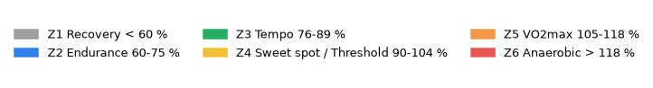

## TSS and Zwift rating

- **TSS** is estimated from the prescribed power (duration x intensity squared); actual TSS depends on how you ride it.
- **Zwift rating** is the in-game "Effort" score (x/5, half-star steps) shown in the workout picker. Zwift computes it from the structure; it depends mostly on intensity (normalised power), so a VO2max session scores higher than a sweet spot session of equal TSS, and micro-intervals (30/30, 10x1) score lower than long blocks.
- Values without `~` were read in Zwift. Values with `~` are predicted by a model fitted on 56 observed sessions (30-second smoothed normalised power with half-star thresholds; 52/56 exact, the rest within half a star). Predictions for the 90-minute rides extrapolate beyond the calibration data and are less certain.

## Installation (Zwift)

1. Copy the seven folders inside [`Zwift/`](Zwift) (`01_Endurance`, `01_Endurance_90min`, `02_SweetSpot` ... `06_OverUnders`) into `~/Documents/Zwift/Workouts/<your Zwift ID>/` (macOS and Windows: the `Documents/Zwift/Workouts/<ID>` folder is created the first time Zwift runs).
2. Restart Zwift. The workouts appear under **Training > Custom Workouts**, grouped by folder.
3. Use the +/- bias in-game (or the FTP setting) if a session is clearly too hard or too easy.

## Installation (MyWhoosh)

MyWhoosh reads the same `.zwo` format, but there is no local workouts folder: every file goes through the web Workout Builder, one at a time. Use the files in [`MyWhoosh/`](MyWhoosh) (same names and folders as the Zwift set).

1. Open [workout.mywhoosh.com](https://workout.mywhoosh.com) and sign in with your MyWhoosh account.
2. Create New > import the `.zwo` file. Check the preview, then click **Export to MyWhoosh**.
3. Quit and relaunch the MyWhoosh app (the list is loaded at startup only). The workout is in **Workouts > MyWorkout**.

Things to know:

- MyWhoosh limits custom workouts with "slots" (free quota not published, more via subscription). Before uploading many files, create one throwaway workout and delete it to check whether deleting frees a slot. If slots are tight, upload only the level you are currently riding (2 files per category) and swap them as you progress.
- The `MyWhoosh/` files differ from the Zwift ones in two ways, because of how MyWhoosh handles captions and ramps: one caption per block (MyWhoosh shows all captions of a block at once, at its start), and the six ramped VO2max intervals (`VO2 L10B`) are written as 1-minute power steps instead of a `Ramp` block. Durations, powers and TSS are identical.

## Suggested weekly structure

- 1 hard session (Threshold, Over-Unders or VO2max), 1 Sweet Spot session, 1-2 Endurance rides (the long one from the 90-minute set), optionally 1 Mixed session.
- Never stack two VO2max days back-to-back. Put the Endurance L01-L02 sessions after the hardest day.
- Base phase: Endurance + Sweet Spot. Build phase: Sweet Spot + Threshold / Over-Unders, then add VO2max. Race prep: Over-Unders L05+ and Mixed L06-L10.
- Fuel every session at level 7 or above with carbohydrates before and during.

## Index

One row per level: variant A, variant B, estimated TSS and Zwift rating (`~` = predicted). Titles link to the detailed card with the graph; the file names link to the `.zwo`.

### [Endurance - 60 min](#endurance---60-min) - `Zwift/01_Endurance`

20 sessions - TSS 27 to 54 - Zwift 1 to 2/5

| Level | Variant A | TSS | Zwift | Variant B | TSS | Zwift |
| --- | --- | --- | --- | --- | --- | --- |
| L01 | [Recovery Spin 40 min @ 55%](#endurance-l01a---recovery-spin-40-min--55) | 28 | ~1/5 | [Recovery Waves 50-58%](#endurance-l01b---recovery-waves-50-58) | 27 | ~1/5 |
| L02 | [Easy Z2 45 min @ 58%](#endurance-l02a---easy-z2-45-min--58) | 31 | ~1/5 | [Easy Z2 2x20 @ 60%](#endurance-l02b---easy-z2-2x20--60) | 32 | ~1/5 |
| L03 | [Z2 45 min @ 62%](#endurance-l03a---z2-45-min--62) | 36 | ~1/5 | [Z2 Waves 58-66%](#endurance-l03b---z2-waves-58-66) | 36 | ~1/5 |
| L04 | [Z2 45 min @ 65%](#endurance-l04a---z2-45-min--65) | 39 | ~1.5/5 | [Z2 Steps 58 to 72%](#endurance-l04b---z2-steps-58-to-72) | 39 | ~1.5/5 |
| L05 | [Z2 45 min @ 68%](#endurance-l05a---z2-45-min--68) | 42 | 1.5/5 | [Z2 2x20 @ 70%](#endurance-l05b---z2-2x20--70) | 42 | 1.5/5 |
| L06 | [Z2 45 min @ 71%](#endurance-l06a---z2-45-min--71) | 45 | 1.5/5 | [Z2 3x12 @ 74%](#endurance-l06b---z2-3x12--74) | 45 | 2/5 |
| L07 | [Z2 45 min @ 73%](#endurance-l07a---z2-45-min--73) | 47 | 2/5 | [Z2 + 3x5 Tempo @ 85%](#endurance-l07b---z2--3x5-tempo--85) | 46 | 2/5 |
| L08 | [Upper Z2 45 min @ 75%](#endurance-l08a---upper-z2-45-min--75) | 49 | 2/5 | [Z2 + 4x5 Tempo @ 85%](#endurance-l08b---z2--4x5-tempo--85) | 49 | 2/5 |
| L09 | [Negative Split 72 to 80%](#endurance-l09a---negative-split-72-to-80) | 51 | 2/5 | [Tempo 3x8 @ 84%](#endurance-l09b---tempo-3x8--84) | 50 | 2/5 |
| L10 | [Low Tempo 45 min @ 78%](#endurance-l10a---low-tempo-45-min--78) | 52 | 2/5 | [Tempo 2x15 @ 85%](#endurance-l10b---tempo-2x15--85) | 54 | 2/5 |

### [Endurance - 90 min](#endurance---90-min) - `Zwift/01_Endurance_90min`

20 sessions - TSS 42 to 83 - Zwift 1.5 to 5/5

| Level | Variant A | TSS | Zwift | Variant B | TSS | Zwift |
| --- | --- | --- | --- | --- | --- | --- |
| L01 | [Recovery Spin 70 min @ 55%](#endurance-90-l01a---recovery-spin-70-min--55) | 43 | ~1.5/5 | [Recovery Waves 50-58%](#endurance-90-l01b---recovery-waves-50-58) | 42 | ~1.5/5 |
| L02 | [Easy Z2 75 min @ 58%](#endurance-90-l02a---easy-z2-75-min--58) | 48 | ~2/5 | [Easy Z2 3x22 @ 60%](#endurance-90-l02b---easy-z2-3x22--60) | 49 | ~2/5 |
| L03 | [Z2 75 min @ 62%](#endurance-90-l03a---z2-75-min--62) | 55 | ~2/5 | [Z2 Waves 58-66%](#endurance-90-l03b---z2-waves-58-66) | 55 | ~2/5 |
| L04 | [Z2 75 min @ 65%](#endurance-90-l04a---z2-75-min--65) | 60 | ~2.5/5 | [Z2 Steps 58 to 72%](#endurance-90-l04b---z2-steps-58-to-72) | 61 | ~2.5/5 |
| L05 | [Z2 75 min @ 68%](#endurance-90-l05a---z2-75-min--68) | 65 | ~3/5 | [Z2 3x22 @ 70%](#endurance-90-l05b---z2-3x22--70) | 66 | ~3/5 |
| L06 | [Z2 75 min @ 71%](#endurance-90-l06a---z2-75-min--71) | 70 | ~3.5/5 | [Z2 4x15 @ 74%](#endurance-90-l06b---z2-4x15--74) | 71 | ~3.5/5 |
| L07 | [Z2 75 min @ 73%](#endurance-90-l07a---z2-75-min--73) | 73 | ~3.5/5 | [Z2 + 5x5 Tempo @ 85%](#endurance-90-l07b---z2--5x5-tempo--85) | 72 | ~4/5 |
| L08 | [Upper Z2 75 min @ 75%](#endurance-90-l08a---upper-z2-75-min--75) | 77 | ~4/5 | [Z2 + 3x10 Tempo @ 85%](#endurance-90-l08b---z2--3x10-tempo--85) | 76 | ~4.5/5 |
| L09 | [Negative Split 72 to 80%](#endurance-90-l09a---negative-split-72-to-80) | 80 | ~4.5/5 | [Tempo 4x10 @ 84%](#endurance-90-l09b---tempo-4x10--84) | 79 | ~4.5/5 |
| L10 | [Low Tempo 75 min @ 78%](#endurance-90-l10a---low-tempo-75-min--78) | 83 | ~4.5/5 | [Tempo 3x15 @ 85%](#endurance-90-l10b---tempo-3x15--85) | 82 | ~5/5 |

### [Sweet Spot - 60 min](#sweet-spot---60-min) - `Zwift/02_SweetSpot`

20 sessions - TSS 48 to 68 - Zwift 2 to 3.5/5

| Level | Variant A | TSS | Zwift | Variant B | TSS | Zwift |
| --- | --- | --- | --- | --- | --- | --- |
| L01 | [2x10 @ 88%](#sweet-spot-l01a---2x10--88) | 49 | 2/5 | [4x5 @ 88%](#sweet-spot-l01b---4x5--88) | 48 | 2/5 |
| L02 | [2x12 @ 88%](#sweet-spot-l02a---2x12--88) | 52 | 2/5 | [3x8 @ 88%](#sweet-spot-l02b---3x8--88) | 51 | 2/5 |
| L03 | [2x15 @ 88%](#sweet-spot-l03a---2x15--88) | 56 | 2.5/5 | [3x10 @ 88%](#sweet-spot-l03b---3x10--88) | 55 | 2.5/5 |
| L04 | [3x10 @ 90%](#sweet-spot-l04a---3x10--90) | 57 | 2.5/5 | [5x6 @ 90% short rest](#sweet-spot-l04b---5x6--90-short-rest) | 57 | 2.5/5 |
| L05 | [2x16 @ 90%](#sweet-spot-l05a---2x16--90) | 59 | 2.5/5 | [4x8 @ 90%](#sweet-spot-l05b---4x8--90) | 58 | 2.5/5 |
| L06 | [2x18 @ 90%](#sweet-spot-l06a---2x18--90) | 62 | 3/5 | [3x12 @ 90%](#sweet-spot-l06b---3x12--90) | 62 | 3/5 |
| L07 | [3x12 @ 92%](#sweet-spot-l07a---3x12--92) | 64 | 3/5 | [Over-Unders 3x12 (95/88)](#sweet-spot-l07b---over-unders-3x12-9588) | 63 | 3/5 |
| L08 | [3x12 @ 93%](#sweet-spot-l08a---3x12--93) | 65 | 3.5/5 | [2x18 @ 92%](#sweet-spot-l08b---2x18--92) | 64 | 3.5/5 |
| L09 | [2x20 @ 92%](#sweet-spot-l09a---2x20--92) | 67 | 3.5/5 | [4x9 @ 94% short rest](#sweet-spot-l09b---4x9--94-short-rest) | 66 | 3.5/5 |
| L10 | [1x40 @ 92%](#sweet-spot-l10a---1x40--92) | 68 | 3.5/5 | [3x13 @ 93%](#sweet-spot-l10b---3x13--93) | 68 | 3.5/5 |

### [Threshold - 60 min](#threshold---60-min) - `Zwift/03_Threshold`

20 sessions - TSS 50 to 78 - Zwift 2 to 4.5/5

| Level | Variant A | TSS | Zwift | Variant B | TSS | Zwift |
| --- | --- | --- | --- | --- | --- | --- |
| L01 | [3x6 @ 95%](#threshold-l01a---3x6--95) | 51 | ~2/5 | [2x8 @ 95%](#threshold-l01b---2x8--95) | 50 | ~2/5 |
| L02 | [2x10 @ 95%](#threshold-l02a---2x10--95) | 54 | ~2.5/5 | [4x5 @ 96%](#threshold-l02b---4x5--96) | 54 | ~2.5/5 |
| L03 | [2x12 @ 95%](#threshold-l03a---2x12--95) | 57 | ~2.5/5 | [3x8 @ 96%](#threshold-l03b---3x8--96) | 57 | ~3/5 |
| L04 | [3x8 @ 98%](#threshold-l04a---3x8--98) | 59 | ~3/5 | [2x12 @ 98%](#threshold-l04b---2x12--98) | 60 | ~3/5 |
| L05 | [3x9 @ 97%](#threshold-l05a---3x9--97) | 61 | 3/5 | [Over-Unders 3x9 (93/105)](#threshold-l05b---over-unders-3x9-93105) | 61 | 3/5 |
| L06 | [2x15 @ 97%](#threshold-l06a---2x15--97) | 65 | 3.5/5 | [3x10 @ 98%](#threshold-l06b---3x10--98) | 65 | 3.5/5 |
| L07 | [3x10 @ 100%](#threshold-l07a---3x10--100) | 67 | 3.5/5 | [5x5 @ 105%](#threshold-l07b---5x5--105) | 67 | 4/5 |
| L08 | [2x18 @ 98%](#threshold-l08a---2x18--98) | 72 | 4/5 | [4x8 @ 102%](#threshold-l08b---4x8--102) | 71 | 4/5 |
| L09 | [3x12 @ 100%](#threshold-l09a---3x12--100) | 74 | 4.5/5 | [2x20 @ 97%](#threshold-l09b---2x20--97) | 74 | 4.5/5 |
| L10 | [2x20 @ 100%](#threshold-l10a---2x20--100) | 78 | 4.5/5 | [3x13 @ 100% short rest](#threshold-l10b---3x13--100-short-rest) | 77 | 4.5/5 |

### [VO2max - 60 min](#vo2max---60-min) - `Zwift/04_VO2max`

20 sessions - TSS 48 to 73 - Zwift 2 to 5/5

| Level | Variant A | TSS | Zwift | Variant B | TSS | Zwift |
| --- | --- | --- | --- | --- | --- | --- |
| L01 | [4x3 @ 108%](#vo2max-l01a---4x3--108) | 48 | 2.5/5 | [10x1 @ 115%](#vo2max-l01b---10x1--115) | 48 | 2/5 |
| L02 | [5x3 @ 108%](#vo2max-l02a---5x3--108) | 52 | 2.5/5 | [6x2 @ 115%](#vo2max-l02b---6x2--115) | 51 | 2.5/5 |
| L03 | [4x4 @ 108%](#vo2max-l03a---4x4--108) | 53 | 3/5 | [5x3 @ 112%](#vo2max-l03b---5x3--112) | 54 | 3/5 |
| L04 | [4x4 @ 115%](#vo2max-l04a---4x4--115) | 57 | 3.5/5 | [30/30 3x10 (120/50)](#vo2max-l04b---3030-3x10-12050) | 58 | 3/5 |
| L05 | [5x4 @ 110%](#vo2max-l05a---5x4--110) | 59 | 3.5/5 | [4x5 @ 110%](#vo2max-l05b---4x5--110) | 59 | 3.5/5 |
| L06 | [5x4 @ 112%](#vo2max-l06a---5x4--112) | 61 | 3.5/5 | [6x3 @ 115%](#vo2max-l06b---6x3--115) | 60 | 3.5/5 |
| L07 | [5x4 @ 115%](#vo2max-l07a---5x4--115) | 63 | ~4/5 | [40/20 3x8 (125/50)](#vo2max-l07b---4020-3x8-12550) | 64 | ~3.5/5 |
| L08 | [6x4 @ 112%](#vo2max-l08a---6x4--112) | 67 | ~4.5/5 | [30/15 3x13 (120/50)](#vo2max-l08b---3015-3x13-12050) | 67 | ~3.5/5 |
| L09 | [5x5 @ 112%](#vo2max-l09a---5x5--112) | 69 | ~4.5/5 | [Hard-Start 6x4 (140 then 110)](#vo2max-l09b---hard-start-6x4-140-then-110) | 70 | ~4.5/5 |
| L10 | [6x4 @ 118%](#vo2max-l10a---6x4--118) | 73 | ~5/5 | [Ramped 6x4 (110 to 125)](#vo2max-l10b---ramped-6x4-110-to-125) | 73 | ~5/5 |

### [Mixed - 60 min](#mixed---60-min) - `Zwift/05_Mixed`

20 sessions - TSS 45 to 71 - Zwift 1.5 to 4.5/5

| Level | Variant A | TSS | Zwift | Variant B | TSS | Zwift |
| --- | --- | --- | --- | --- | --- | --- |
| L01 | [Z2 + 4x1 @ 120%](#mixed-l01a---z2--4x1--120) | 47 | ~2/5 | [Z2 + 6 Sprints](#mixed-l01b---z2--6-sprints) | 45 | ~1.5/5 |
| L02 | [Z2 + Tempo Finish](#mixed-l02a---z2--tempo-finish) | 50 | ~2/5 | [Tempo 3x8 @ 82% + Sprints](#mixed-l02b---tempo-3x8--82--sprints) | 49 | ~2/5 |
| L03 | [Tempo 3x10 @ 82% + Sprints](#mixed-l03a---tempo-3x10--82--sprints) | 52 | ~2/5 | [Z2 + 4x1 @ 130%](#mixed-l03b---z2--4x1--130) | 51 | ~2.5/5 |
| L04 | [Sweet Spot 2x10 + 3x1 @ 120%](#mixed-l04a---sweet-spot-2x10--3x1--120) | 54 | ~2.5/5 | [Descending 92 / 88 / 84%](#mixed-l04b---descending-92--88--84) | 55 | ~2.5/5 |
| L05 | [Light Over-Unders 3x10 (95/85)](#mixed-l05a---light-over-unders-3x10-9585) | 57 | ~2.5/5 | [Zone Ladder Tempo-SS-Threshold](#mixed-l05b---zone-ladder-tempo-ss-threshold) | 57 | ~2.5/5 |
| L06 | [Sweet Spot 2x10 + 4x2 @ 118%](#mixed-l06a---sweet-spot-2x10--4x2--118) | 62 | ~3.5/5 | [Climb Simulation 20 + 12](#mixed-l06b---climb-simulation-20--12) | 62 | ~3/5 |
| L07 | [Zone Pyramid Tempo-THR-VO2-THR-Tempo](#mixed-l07a---zone-pyramid-tempo-thr-vo2-thr-tempo) | 63 | ~3.5/5 | [Anaerobic 20/40 x2 + Sweet Spot](#mixed-l07b---anaerobic-2040-x2--sweet-spot) | 63 | ~3/5 |
| L08 | [Race Simulation](#mixed-l08a---race-simulation) | 65 | ~4/5 | [Over-Under Pyramid 4-6-8-6-4](#mixed-l08b---over-under-pyramid-4-6-8-6-4) | 65 | ~3.5/5 |
| L09 | [Kitchen Sink](#mixed-l09a---kitchen-sink) | 67 | ~4/5 | [Threshold 2x10 @ 102% + 3x2 @ 120%](#mixed-l09b---threshold-2x10--102--3x2--120) | 67 | ~4/5 |
| L10 | [Threshold 2x8 + 4x3 @ 118%](#mixed-l10a---threshold-2x8--4x3--118) | 71 | ~4.5/5 | [Hard Race Simulation](#mixed-l10b---hard-race-simulation) | 71 | ~4.5/5 |

### [Over-Unders - 60 min](#over-unders---60-min) - `Zwift/06_OverUnders`

20 sessions - TSS 47 to 79 - Zwift 2 to 5/5

| Level | Variant A | TSS | Zwift | Variant B | TSS | Zwift |
| --- | --- | --- | --- | --- | --- | --- |
| L01 | [Intro 2x8 (85/92)](#over-unders-l01a---intro-2x8-8592) | 47 | ~2/5 | [Intro 3x6 (85/95)](#over-unders-l01b---intro-3x6-8595) | 49 | ~2/5 |
| L02 | [3x8 (85/95)](#over-unders-l02a---3x8-8595) | 53 | ~2.5/5 | [2x12 (88/95)](#over-unders-l02b---2x12-8895) | 55 | ~2.5/5 |
| L03 | [3x10 (85/95)](#over-unders-l03a---3x10-8595) | 58 | ~2.5/5 | [3x9 (90/100) 2+1](#over-unders-l03b---3x9-90100-21) | 58 | ~3/5 |
| L04 | [3x10 (88/95)](#over-unders-l04a---3x10-8895) | 59 | ~3/5 | [3x8 (90/102) 1+1](#over-unders-l04b---3x8-90102-11) | 58 | ~3/5 |
| L05 | [3x9 (93/105) 2+1](#over-unders-l05a---3x9-93105-21) | 62 | ~3/5 | [2x15 (92/102) 2+1](#over-unders-l05b---2x15-92102-21) | 63 | ~3.5/5 |
| L06 | [2x15 (93/105) 2+1](#over-unders-l06a---2x15-93105-21) | 65 | ~3.5/5 | [3x10 (90/105) 1+1](#over-unders-l06b---3x10-90105-11) | 65 | ~3.5/5 |
| L07 | [3x12 (93/105) 2+1](#over-unders-l07a---3x12-93105-21) | 70 | ~4/5 | [4x8 (90/110) 1+1](#over-unders-l07b---4x8-90110-11) | 70 | ~4/5 |
| L08 | [3x12 (95/108) 2+1](#over-unders-l08a---3x12-95108-21) | 73 | ~4.5/5 | [Pyramid 4-8-10-8-4 (90 / 105-115)](#over-unders-l08b---pyramid-4-8-10-8-4-90--105-115) | 72 | ~4.5/5 |
| L09 | [2x18 (95/110) 2+1](#over-unders-l09a---2x18-95110-21) | 74 | ~4.5/5 | [3x12 (92/110) 1+1](#over-unders-l09b---3x12-92110-11) | 76 | ~4.5/5 |
| L10 | [2x20 (95/112) 3+1](#over-unders-l10a---2x20-95112-31) | 78 | ~4.5/5 | [3x12 (93/115) 1+1](#over-unders-l10b---3x12-93115-11) | 79 | ~5/5 |

## Catalogue

### Endurance - 60 min

Zone 2 up to low tempo. Aerobic base, active recovery, easy days. Files: [`Zwift/01_Endurance`](Zwift/01_Endurance) - [`MyWhoosh/01_Endurance`](MyWhoosh/01_Endurance) - [back to index](#index)

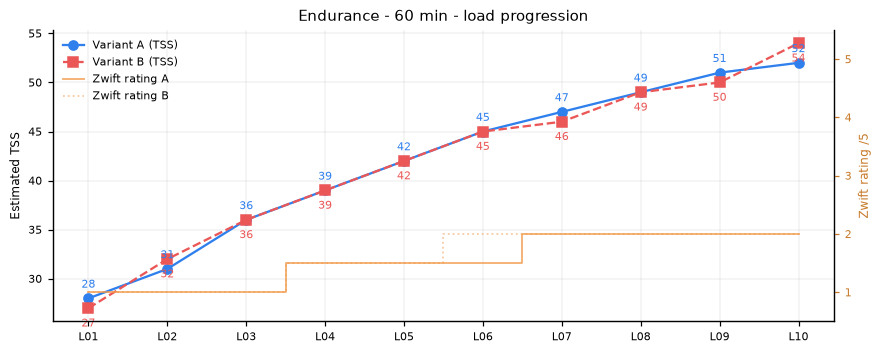

#### Endurance L01A - Recovery Spin 40 min @ 55%

**60 min - TSS 28 - Zwift ~1/5** - [`END_L01A_Recovery_Spin_40_min_55.zwo`](Zwift/01_Endurance/END_L01A_Recovery_Spin_40_min_55.zwo) ([MyWhoosh version](MyWhoosh/01_Endurance/END_L01A_Recovery_Spin_40_min_55.zwo))

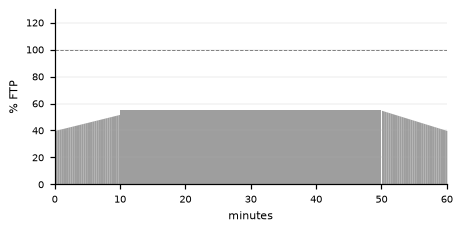

10 min warm-up, 40 min @ 55%, 10 min cool-down.

*Pure recovery. Finish fresher than you started; lower the bias if 55% feels like work.*

#### Endurance L01B - Recovery Waves 50-58%

**60 min - TSS 27 - Zwift ~1/5** - [`END_L01B_Recovery_Waves_50-58.zwo`](Zwift/01_Endurance/END_L01B_Recovery_Waves_50-58.zwo) ([MyWhoosh version](MyWhoosh/01_Endurance/END_L01B_Recovery_Waves_50-58.zwo))

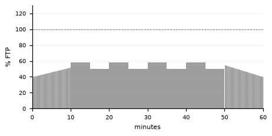

10 min warm-up, 4 x (5 min @ 58% / 5 min @ 50%), 10 min cool-down.

*Recovery ride with gentle waves to keep it interesting. Nothing above low Zone 2.*

#### Endurance L02A - Easy Z2 45 min @ 58%

**60 min - TSS 31 - Zwift ~1/5** - [`END_L02A_Easy_Z2_45_min_58.zwo`](Zwift/01_Endurance/END_L02A_Easy_Z2_45_min_58.zwo) ([MyWhoosh version](MyWhoosh/01_Endurance/END_L02A_Easy_Z2_45_min_58.zwo))

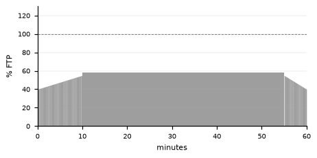

10 min warm-up, 45 min @ 58%, 5 min cool-down.

*Low Zone 2 all the way. Conversational pace, no surges.*

#### Endurance L02B - Easy Z2 2x20 @ 60%

**60 min - TSS 32 - Zwift ~1/5** - [`END_L02B_Easy_Z2_2x20_60.zwo`](Zwift/01_Endurance/END_L02B_Easy_Z2_2x20_60.zwo) ([MyWhoosh version](MyWhoosh/01_Endurance/END_L02B_Easy_Z2_2x20_60.zwo))

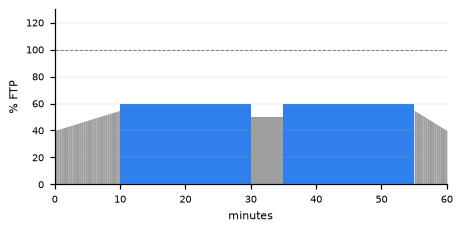

10 min warm-up, 20 min @ 60%, 5 min @ 50%, 20 min @ 60%, 5 min cool-down.

*Two easy blocks with a short break. Good the day after a hard session.*

#### Endurance L03A - Z2 45 min @ 62%

**60 min - TSS 36 - Zwift ~1/5** - [`END_L03A_Z2_45_min_62.zwo`](Zwift/01_Endurance/END_L03A_Z2_45_min_62.zwo) ([MyWhoosh version](MyWhoosh/01_Endurance/END_L03A_Z2_45_min_62.zwo))

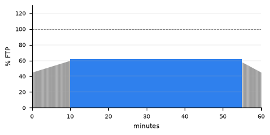

10 min warm-up, 45 min @ 62%, 5 min cool-down.

*Classic low-to-mid Zone 2. Steady pressure through the whole pedal stroke.*

#### Endurance L03B - Z2 Waves 58-66%

**60 min - TSS 36 - Zwift ~1/5** - [`END_L03B_Z2_Waves_58-66.zwo`](Zwift/01_Endurance/END_L03B_Z2_Waves_58-66.zwo) ([MyWhoosh version](MyWhoosh/01_Endurance/END_L03B_Z2_Waves_58-66.zwo))

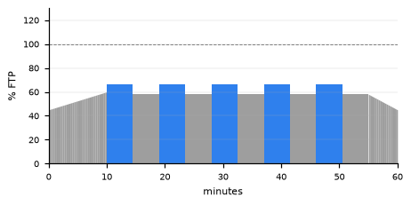

10 min warm-up, 5 x (4:30 @ 66% / 4:30 @ 58%), 5 min cool-down.

*Rolling Zone 2: shift gears to change power, keep pedalling smoothly.*

#### Endurance L04A - Z2 45 min @ 65%

**60 min - TSS 39 - Zwift ~1.5/5** - [`END_L04A_Z2_45_min_65.zwo`](Zwift/01_Endurance/END_L04A_Z2_45_min_65.zwo) ([MyWhoosh version](MyWhoosh/01_Endurance/END_L04A_Z2_45_min_65.zwo))

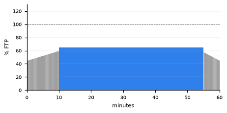

10 min warm-up, 45 min @ 65%, 5 min cool-down.

*Mid Zone 2. The classic aerobic base ride.*

#### Endurance L04B - Z2 Steps 58 to 72%

**60 min - TSS 39 - Zwift ~1.5/5** - [`END_L04B_Z2_Steps_58_to_72.zwo`](Zwift/01_Endurance/END_L04B_Z2_Steps_58_to_72.zwo) ([MyWhoosh version](MyWhoosh/01_Endurance/END_L04B_Z2_Steps_58_to_72.zwo))

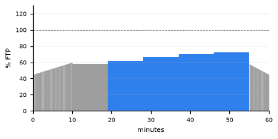

10 min warm-up, 9 min @ 58%, 9 min @ 62%, 9 min @ 66%, 9 min @ 70%, 9 min @ 72%, 5 min cool-down.

*Five 9-minute steps rising through Zone 2. Heart rate should rise only slightly per step.*

#### Endurance L05A - Z2 45 min @ 68%

**60 min - TSS 42 - Zwift 1.5/5** - [`END_L05A_Z2_45_min_68.zwo`](Zwift/01_Endurance/END_L05A_Z2_45_min_68.zwo) ([MyWhoosh version](MyWhoosh/01_Endurance/END_L05A_Z2_45_min_68.zwo))

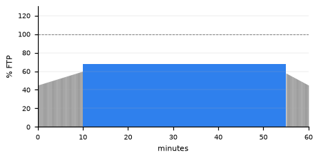

10 min warm-up, 45 min @ 68%, 5 min cool-down.

*Solid Zone 2. You should still be able to speak in full sentences.*

#### Endurance L05B - Z2 2x20 @ 70%

**60 min - TSS 42 - Zwift 1.5/5** - [`END_L05B_Z2_2x20_70.zwo`](Zwift/01_Endurance/END_L05B_Z2_2x20_70.zwo) ([MyWhoosh version](MyWhoosh/01_Endurance/END_L05B_Z2_2x20_70.zwo))

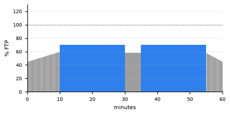

10 min warm-up, 20 min @ 70%, 5 min @ 58%, 20 min @ 70%, 5 min cool-down.

*Two structured Zone 2 blocks. Hold the power line flat on the second one.*

#### Endurance L06A - Z2 45 min @ 71%

**60 min - TSS 45 - Zwift 1.5/5** - [`END_L06A_Z2_45_min_71.zwo`](Zwift/01_Endurance/END_L06A_Z2_45_min_71.zwo) ([MyWhoosh version](MyWhoosh/01_Endurance/END_L06A_Z2_45_min_71.zwo))

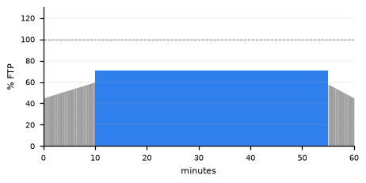

10 min warm-up, 45 min @ 71%, 5 min cool-down.

*Upper-mid Zone 2. Demands concentration to avoid drifting up into tempo.*

#### Endurance L06B - Z2 3x12 @ 74%

**60 min - TSS 45 - Zwift 2/5** - [`END_L06B_Z2_3x12_74.zwo`](Zwift/01_Endurance/END_L06B_Z2_3x12_74.zwo) ([MyWhoosh version](MyWhoosh/01_Endurance/END_L06B_Z2_3x12_74.zwo))

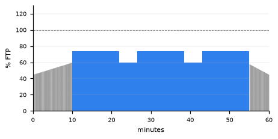

10 min warm-up, 12 min @ 74%, 4:30 @ 60%, 12 min @ 74%, 4:30 @ 60%, 12 min @ 74%, 5 min cool-down.

*Three blocks near the top of Zone 2 with short easy breaks.*

#### Endurance L07A - Z2 45 min @ 73%

**60 min - TSS 47 - Zwift 2/5** - [`END_L07A_Z2_45_min_73.zwo`](Zwift/01_Endurance/END_L07A_Z2_45_min_73.zwo) ([MyWhoosh version](MyWhoosh/01_Endurance/END_L07A_Z2_45_min_73.zwo))


10 min warm-up, 45 min @ 73%, 5 min cool-down.

*Near the top of Zone 2 for 45 minutes. Breathing deeper but controlled.*

#### Endurance L07B - Z2 + 3x5 Tempo @ 85%

**60 min - TSS 46 - Zwift 2/5** - [`END_L07B_Z2_plus_3x5_Tempo_85.zwo`](Zwift/01_Endurance/END_L07B_Z2_plus_3x5_Tempo_85.zwo) ([MyWhoosh version](MyWhoosh/01_Endurance/END_L07B_Z2_plus_3x5_Tempo_85.zwo))

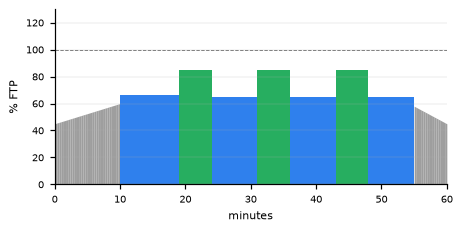

10 min warm-up, 9 min @ 66%, 3 x (5 min @ 85% / 7 min @ 65%), 5 min cool-down.

*Zone 2 base with three tempo touches. Same rhythm, just add pressure.*

#### Endurance L08A - Upper Z2 45 min @ 75%

**60 min - TSS 49 - Zwift 2/5** - [`END_L08A_Upper_Z2_45_min_75.zwo`](Zwift/01_Endurance/END_L08A_Upper_Z2_45_min_75.zwo) ([MyWhoosh version](MyWhoosh/01_Endurance/END_L08A_Upper_Z2_45_min_75.zwo))

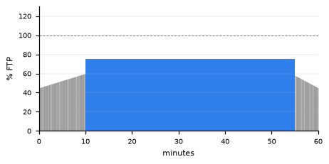

10 min warm-up, 45 min @ 75%, 5 min cool-down.

*The very top of Zone 2 for 45 minutes. Still aerobic, but no longer easy.*

#### Endurance L08B - Z2 + 4x5 Tempo @ 85%

**60 min - TSS 49 - Zwift 2/5** - [`END_L08B_Z2_plus_4x5_Tempo_85.zwo`](Zwift/01_Endurance/END_L08B_Z2_plus_4x5_Tempo_85.zwo) ([MyWhoosh version](MyWhoosh/01_Endurance/END_L08B_Z2_plus_4x5_Tempo_85.zwo))


10 min warm-up, 5 min @ 68%, 4 x (5 min @ 85% / 5 min @ 66%), 5 min cool-down.

*Four tempo touches inside a Zone 2 ride. Controlled, never hard.*

#### Endurance L09A - Negative Split 72 to 80%

**60 min - TSS 51 - Zwift 2/5** - [`END_L09A_Negative_Split_72_to_80.zwo`](Zwift/01_Endurance/END_L09A_Negative_Split_72_to_80.zwo) ([MyWhoosh version](MyWhoosh/01_Endurance/END_L09A_Negative_Split_72_to_80.zwo))

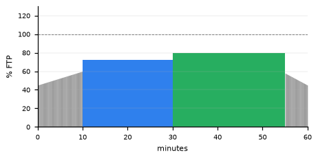

10 min warm-up, 20 min @ 72%, 25 min @ 80%, 5 min cool-down.

*Zone 2 then low tempo. The second half should feel like a deliberate step up.*

#### Endurance L09B - Tempo 3x8 @ 84%

**60 min - TSS 50 - Zwift 2/5** - [`END_L09B_Tempo_3x8_84.zwo`](Zwift/01_Endurance/END_L09B_Tempo_3x8_84.zwo) ([MyWhoosh version](MyWhoosh/01_Endurance/END_L09B_Tempo_3x8_84.zwo))

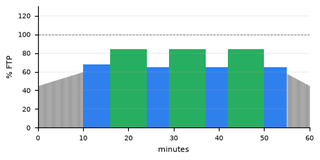

10 min warm-up, 6 min @ 68%, 3 x (8 min @ 84% / 5 min @ 65%), 5 min cool-down.

*Three tempo blocks with Zone 2 recoveries. Rhythmic and controlled.*

#### Endurance L10A - Low Tempo 45 min @ 78%

**60 min - TSS 52 - Zwift 2/5** - [`END_L10A_Low_Tempo_45_min_78.zwo`](Zwift/01_Endurance/END_L10A_Low_Tempo_45_min_78.zwo) ([MyWhoosh version](MyWhoosh/01_Endurance/END_L10A_Low_Tempo_45_min_78.zwo))

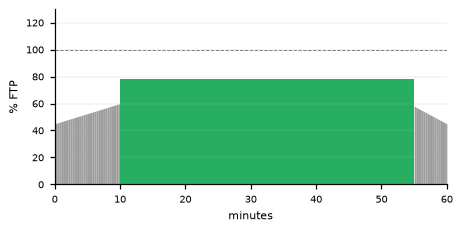

10 min warm-up, 45 min @ 78%, 5 min cool-down.

*A full 45 minutes of low tempo. Bridge between endurance and sweet spot.*

#### Endurance L10B - Tempo 2x15 @ 85%

**60 min - TSS 54 - Zwift 2/5** - [`END_L10B_Tempo_2x15_85.zwo`](Zwift/01_Endurance/END_L10B_Tempo_2x15_85.zwo) ([MyWhoosh version](MyWhoosh/01_Endurance/END_L10B_Tempo_2x15_85.zwo))

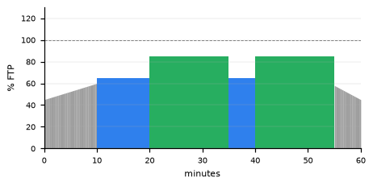

10 min warm-up, 10 min @ 65%, 15 min @ 85%, 5 min @ 65%, 15 min @ 85%, 5 min cool-down.

*Two 15-minute tempo blocks. The hardest endurance session in the library.*

### Endurance - 90 min

Same ladder as the 60-minute endurance set with a 75-minute main set. For the long ride of the week; ride one level below your 60-minute endurance level if in doubt. Files: [`Zwift/01_Endurance_90min`](Zwift/01_Endurance_90min) - [`MyWhoosh/01_Endurance_90min`](MyWhoosh/01_Endurance_90min) - [back to index](#index)

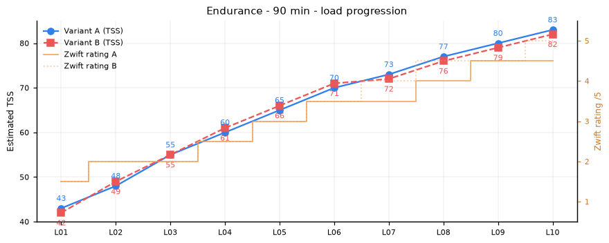

#### Endurance 90 L01A - Recovery Spin 70 min @ 55%

**90 min - TSS 43 - Zwift ~1.5/5** - [`END90_L01A_Recovery_Spin_70_min_55.zwo`](Zwift/01_Endurance_90min/END90_L01A_Recovery_Spin_70_min_55.zwo) ([MyWhoosh version](MyWhoosh/01_Endurance_90min/END90_L01A_Recovery_Spin_70_min_55.zwo))

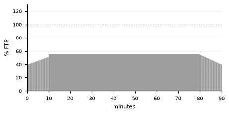

10 min warm-up, 70 min @ 55%, 10 min cool-down.

*Long but very easy. Finish fresher than you started; lower the bias if 55% feels like work. Eat 40-60 g of carbohydrate per hour on rides this long.*

#### Endurance 90 L01B - Recovery Waves 50-58%

**90 min - TSS 42 - Zwift ~1.5/5** - [`END90_L01B_Recovery_Waves_50-58.zwo`](Zwift/01_Endurance_90min/END90_L01B_Recovery_Waves_50-58.zwo) ([MyWhoosh version](MyWhoosh/01_Endurance_90min/END90_L01B_Recovery_Waves_50-58.zwo))

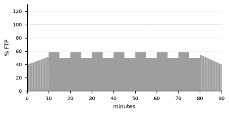

10 min warm-up, 7 x (5 min @ 58% / 5 min @ 50%), 10 min cool-down.

*Gentle waves to keep a long recovery ride interesting. Nothing above low Zone 2. Eat 40-60 g of carbohydrate per hour on rides this long.*

#### Endurance 90 L02A - Easy Z2 75 min @ 58%

**90 min - TSS 48 - Zwift ~2/5** - [`END90_L02A_Easy_Z2_75_min_58.zwo`](Zwift/01_Endurance_90min/END90_L02A_Easy_Z2_75_min_58.zwo) ([MyWhoosh version](MyWhoosh/01_Endurance_90min/END90_L02A_Easy_Z2_75_min_58.zwo))

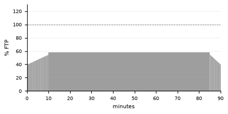

10 min warm-up, 75 min @ 58%, 5 min cool-down.

*Low Zone 2 for 75 minutes. Conversational pace, no surges. Eat 40-60 g of carbohydrate per hour on rides this long.*

#### Endurance 90 L02B - Easy Z2 3x22 @ 60%

**90 min - TSS 49 - Zwift ~2/5** - [`END90_L02B_Easy_Z2_3x22_60.zwo`](Zwift/01_Endurance_90min/END90_L02B_Easy_Z2_3x22_60.zwo) ([MyWhoosh version](MyWhoosh/01_Endurance_90min/END90_L02B_Easy_Z2_3x22_60.zwo))

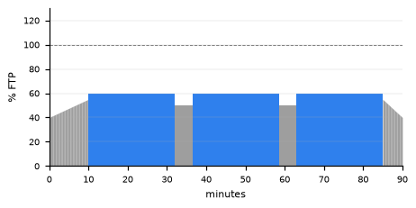

10 min warm-up, 22 min @ 60%, 4:30 @ 50%, 22 min @ 60%, 4:30 @ 50%, 22 min @ 60%, 5 min cool-down.

*Three easy blocks with short breaks. Good the day after a hard session or race. Eat 40-60 g of carbohydrate per hour on rides this long.*

#### Endurance 90 L03A - Z2 75 min @ 62%

**90 min - TSS 55 - Zwift ~2/5** - [`END90_L03A_Z2_75_min_62.zwo`](Zwift/01_Endurance_90min/END90_L03A_Z2_75_min_62.zwo) ([MyWhoosh version](MyWhoosh/01_Endurance_90min/END90_L03A_Z2_75_min_62.zwo))

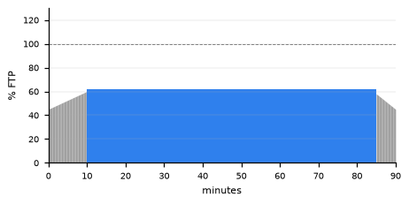

10 min warm-up, 75 min @ 62%, 5 min cool-down.

*Classic low-to-mid Zone 2. Steady pressure through the whole pedal stroke. Eat 40-60 g of carbohydrate per hour on rides this long.*

#### Endurance 90 L03B - Z2 Waves 58-66%

**90 min - TSS 55 - Zwift ~2/5** - [`END90_L03B_Z2_Waves_58-66.zwo`](Zwift/01_Endurance_90min/END90_L03B_Z2_Waves_58-66.zwo) ([MyWhoosh version](MyWhoosh/01_Endurance_90min/END90_L03B_Z2_Waves_58-66.zwo))

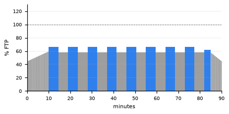

10 min warm-up, 8 x (4:30 @ 66% / 4:30 @ 58%), 3 min @ 62%, 5 min cool-down.

*Rolling Zone 2 for 72 minutes: shift gears to change power, keep pedalling smoothly. Eat 40-60 g of carbohydrate per hour on rides this long.*

#### Endurance 90 L04A - Z2 75 min @ 65%

**90 min - TSS 60 - Zwift ~2.5/5** - [`END90_L04A_Z2_75_min_65.zwo`](Zwift/01_Endurance_90min/END90_L04A_Z2_75_min_65.zwo) ([MyWhoosh version](MyWhoosh/01_Endurance_90min/END90_L04A_Z2_75_min_65.zwo))

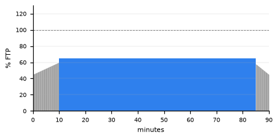

10 min warm-up, 75 min @ 65%, 5 min cool-down.

*Mid Zone 2 for 75 minutes. The classic aerobic base ride. Eat 40-60 g of carbohydrate per hour on rides this long.*

#### Endurance 90 L04B - Z2 Steps 58 to 72%

**90 min - TSS 61 - Zwift ~2.5/5** - [`END90_L04B_Z2_Steps_58_to_72.zwo`](Zwift/01_Endurance_90min/END90_L04B_Z2_Steps_58_to_72.zwo) ([MyWhoosh version](MyWhoosh/01_Endurance_90min/END90_L04B_Z2_Steps_58_to_72.zwo))

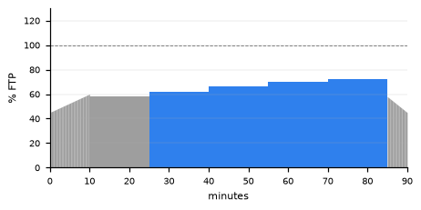

10 min warm-up, 15 min @ 58%, 15 min @ 62%, 15 min @ 66%, 15 min @ 70%, 15 min @ 72%, 5 min cool-down.

*Five 15-minute steps rising through Zone 2. Heart rate should rise only slightly per step. Eat 40-60 g of carbohydrate per hour on rides this long.*

#### Endurance 90 L05A - Z2 75 min @ 68%

**90 min - TSS 65 - Zwift ~3/5** - [`END90_L05A_Z2_75_min_68.zwo`](Zwift/01_Endurance_90min/END90_L05A_Z2_75_min_68.zwo) ([MyWhoosh version](MyWhoosh/01_Endurance_90min/END90_L05A_Z2_75_min_68.zwo))

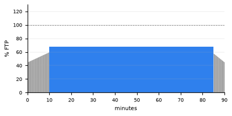

10 min warm-up, 75 min @ 68%, 5 min cool-down.

*Solid Zone 2 for 75 minutes. You should still be able to speak in full sentences. Eat 40-60 g of carbohydrate per hour on rides this long.*

#### Endurance 90 L05B - Z2 3x22 @ 70%

**90 min - TSS 66 - Zwift ~3/5** - [`END90_L05B_Z2_3x22_70.zwo`](Zwift/01_Endurance_90min/END90_L05B_Z2_3x22_70.zwo) ([MyWhoosh version](MyWhoosh/01_Endurance_90min/END90_L05B_Z2_3x22_70.zwo))

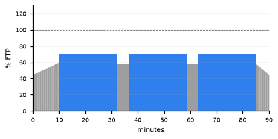

10 min warm-up, 22 min @ 70%, 4:30 @ 58%, 22 min @ 70%, 4:30 @ 58%, 22 min @ 70%, 5 min cool-down.

*Three structured Zone 2 blocks. Hold the power line flat on the third one. Eat 40-60 g of carbohydrate per hour on rides this long.*

#### Endurance 90 L06A - Z2 75 min @ 71%

**90 min - TSS 70 - Zwift ~3.5/5** - [`END90_L06A_Z2_75_min_71.zwo`](Zwift/01_Endurance_90min/END90_L06A_Z2_75_min_71.zwo) ([MyWhoosh version](MyWhoosh/01_Endurance_90min/END90_L06A_Z2_75_min_71.zwo))

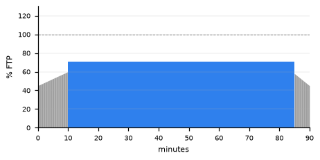

10 min warm-up, 75 min @ 71%, 5 min cool-down.

*Upper-mid Zone 2 for 75 minutes. Concentration needed to avoid drifting into tempo. Eat 40-60 g of carbohydrate per hour on rides this long.*

#### Endurance 90 L06B - Z2 4x15 @ 74%

**90 min - TSS 71 - Zwift ~3.5/5** - [`END90_L06B_Z2_4x15_74.zwo`](Zwift/01_Endurance_90min/END90_L06B_Z2_4x15_74.zwo) ([MyWhoosh version](MyWhoosh/01_Endurance_90min/END90_L06B_Z2_4x15_74.zwo))


10 min warm-up, 15 min @ 74%, 5 min @ 60%, 15 min @ 74%, 5 min @ 60%, 15 min @ 74%, 5 min @ 60%, 15 min @ 74%, 5 min cool-down.

*Four blocks near the top of Zone 2 with short easy breaks. Eat 40-60 g of carbohydrate per hour on rides this long.*

#### Endurance 90 L07A - Z2 75 min @ 73%

**90 min - TSS 73 - Zwift ~3.5/5** - [`END90_L07A_Z2_75_min_73.zwo`](Zwift/01_Endurance_90min/END90_L07A_Z2_75_min_73.zwo) ([MyWhoosh version](MyWhoosh/01_Endurance_90min/END90_L07A_Z2_75_min_73.zwo))

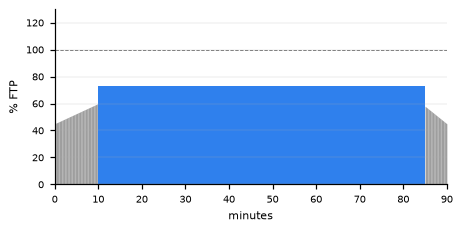

10 min warm-up, 75 min @ 73%, 5 min cool-down.

*Near the top of Zone 2 for 75 minutes. Breathing deeper but controlled. Eat 40-60 g of carbohydrate per hour on rides this long.*

#### Endurance 90 L07B - Z2 + 5x5 Tempo @ 85%

**90 min - TSS 72 - Zwift ~4/5** - [`END90_L07B_Z2_plus_5x5_Tempo_85.zwo`](Zwift/01_Endurance_90min/END90_L07B_Z2_plus_5x5_Tempo_85.zwo) ([MyWhoosh version](MyWhoosh/01_Endurance_90min/END90_L07B_Z2_plus_5x5_Tempo_85.zwo))

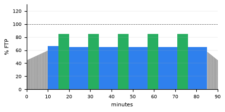

10 min warm-up, 5 min @ 66%, 5 x (5 min @ 85% / 9 min @ 65%), 5 min cool-down.

*Zone 2 base with five tempo touches spread across the ride. Same rhythm, just add pressure. Eat 40-60 g of carbohydrate per hour on rides this long.*

#### Endurance 90 L08A - Upper Z2 75 min @ 75%

**90 min - TSS 77 - Zwift ~4/5** - [`END90_L08A_Upper_Z2_75_min_75.zwo`](Zwift/01_Endurance_90min/END90_L08A_Upper_Z2_75_min_75.zwo) ([MyWhoosh version](MyWhoosh/01_Endurance_90min/END90_L08A_Upper_Z2_75_min_75.zwo))

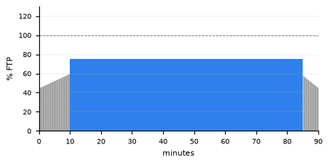

10 min warm-up, 75 min @ 75%, 5 min cool-down.

*The very top of Zone 2 for 75 minutes. Still aerobic, but no longer easy. Eat 40-60 g of carbohydrate per hour on rides this long.*

#### Endurance 90 L08B - Z2 + 3x10 Tempo @ 85%

**90 min - TSS 76 - Zwift ~4.5/5** - [`END90_L08B_Z2_plus_3x10_Tempo_85.zwo`](Zwift/01_Endurance_90min/END90_L08B_Z2_plus_3x10_Tempo_85.zwo) ([MyWhoosh version](MyWhoosh/01_Endurance_90min/END90_L08B_Z2_plus_3x10_Tempo_85.zwo))

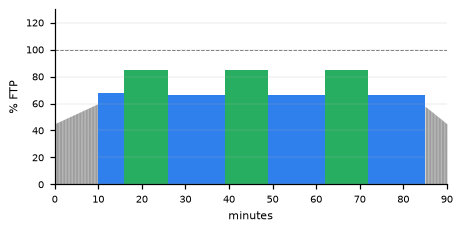

10 min warm-up, 6 min @ 68%, 3 x (10 min @ 85% / 13 min @ 66%), 5 min cool-down.

*Three 10-minute tempo blocks inside a long Zone 2 ride. Controlled, never hard. Eat 40-60 g of carbohydrate per hour on rides this long.*

#### Endurance 90 L09A - Negative Split 72 to 80%

**90 min - TSS 80 - Zwift ~4.5/5** - [`END90_L09A_Negative_Split_72_to_80.zwo`](Zwift/01_Endurance_90min/END90_L09A_Negative_Split_72_to_80.zwo) ([MyWhoosh version](MyWhoosh/01_Endurance_90min/END90_L09A_Negative_Split_72_to_80.zwo))

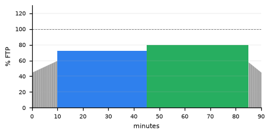

10 min warm-up, 35 min @ 72%, 40 min @ 80%, 5 min cool-down.

*35 min Zone 2 then 40 min low tempo. The second part should feel like a deliberate step up. Eat 40-60 g of carbohydrate per hour on rides this long.*

#### Endurance 90 L09B - Tempo 4x10 @ 84%

**90 min - TSS 79 - Zwift ~4.5/5** - [`END90_L09B_Tempo_4x10_84.zwo`](Zwift/01_Endurance_90min/END90_L09B_Tempo_4x10_84.zwo) ([MyWhoosh version](MyWhoosh/01_Endurance_90min/END90_L09B_Tempo_4x10_84.zwo))

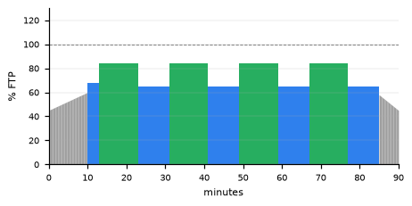

10 min warm-up, 3 min @ 68%, 4 x (10 min @ 84% / 8 min @ 65%), 5 min cool-down.

*Four tempo blocks with Zone 2 recoveries. Rhythmic and controlled. Eat 40-60 g of carbohydrate per hour on rides this long.*

#### Endurance 90 L10A - Low Tempo 75 min @ 78%

**90 min - TSS 83 - Zwift ~4.5/5** - [`END90_L10A_Low_Tempo_75_min_78.zwo`](Zwift/01_Endurance_90min/END90_L10A_Low_Tempo_75_min_78.zwo) ([MyWhoosh version](MyWhoosh/01_Endurance_90min/END90_L10A_Low_Tempo_75_min_78.zwo))

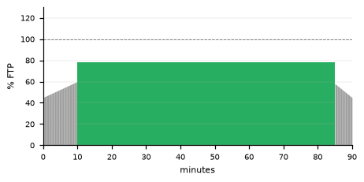

10 min warm-up, 75 min @ 78%, 5 min cool-down.

*A full 75 minutes of low tempo. The bridge between endurance and sweet spot. Eat 40-60 g of carbohydrate per hour on rides this long.*

#### Endurance 90 L10B - Tempo 3x15 @ 85%

**90 min - TSS 82 - Zwift ~5/5** - [`END90_L10B_Tempo_3x15_85.zwo`](Zwift/01_Endurance_90min/END90_L10B_Tempo_3x15_85.zwo) ([MyWhoosh version](MyWhoosh/01_Endurance_90min/END90_L10B_Tempo_3x15_85.zwo))

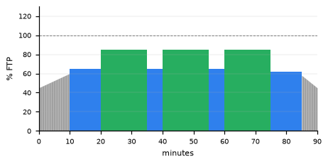

10 min warm-up, 10 min @ 65%, 15 min @ 85%, 5 min @ 65%, 15 min @ 85%, 5 min @ 65%, 15 min @ 85%, 10 min @ 62%, 5 min cool-down.

*Three 15-minute tempo blocks. The hardest endurance session in the library. Eat 40-60 g of carbohydrate per hour on rides this long.*

### Sweet Spot - 60 min

88-94 % FTP. The best load-to-fatigue ratio for building sustained power. Files: [`Zwift/02_SweetSpot`](Zwift/02_SweetSpot) - [`MyWhoosh/02_SweetSpot`](MyWhoosh/02_SweetSpot) - [back to index](#index)

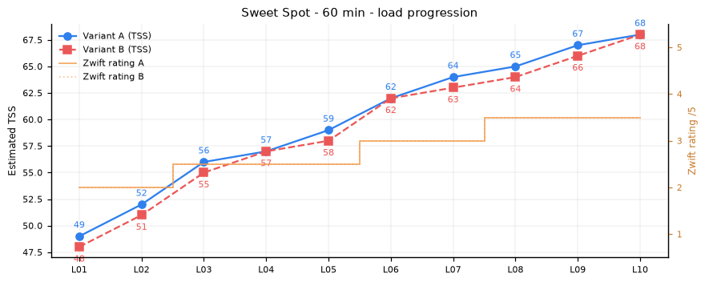

#### Sweet Spot L01A - 2x10 @ 88%

**60 min - TSS 49 - Zwift 2/5** - [`SS_L01A_2x10_88.zwo`](Zwift/02_SweetSpot/SS_L01A_2x10_88.zwo) ([MyWhoosh version](MyWhoosh/02_SweetSpot/SS_L01A_2x10_88.zwo))

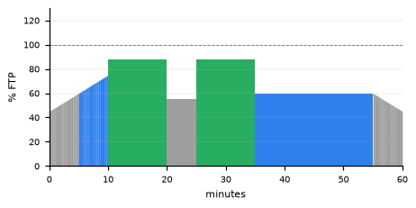

10 min warm-up, 10 min @ 88%, 5 min @ 55%, 10 min @ 88%, 20 min @ 60%, 5 min cool-down.

*First sweet spot session of a block. Even pacing, no fade in the last 2 minutes.*

#### Sweet Spot L01B - 4x5 @ 88%

**60 min - TSS 48 - Zwift 2/5** - [`SS_L01B_4x5_88.zwo`](Zwift/02_SweetSpot/SS_L01B_4x5_88.zwo) ([MyWhoosh version](MyWhoosh/02_SweetSpot/SS_L01B_4x5_88.zwo))

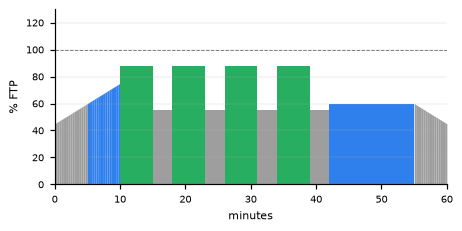

10 min warm-up, 4 x (5 min @ 88% / 3 min @ 55%), 13 min @ 60%, 5 min cool-down.

*Short blocks to learn the sweet spot feeling: comfortably hard, sustainable.*

#### Sweet Spot L02A - 2x12 @ 88%

**60 min - TSS 52 - Zwift 2/5** - [`SS_L02A_2x12_88.zwo`](Zwift/02_SweetSpot/SS_L02A_2x12_88.zwo) ([MyWhoosh version](MyWhoosh/02_SweetSpot/SS_L02A_2x12_88.zwo))

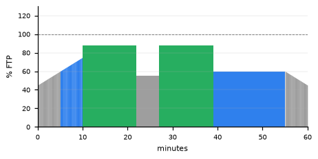

10 min warm-up, 12 min @ 88%, 5 min @ 55%, 12 min @ 88%, 16 min @ 60%, 5 min cool-down.

*Slightly longer blocks at low sweet spot.*

#### Sweet Spot L02B - 3x8 @ 88%

**60 min - TSS 51 - Zwift 2/5** - [`SS_L02B_3x8_88.zwo`](Zwift/02_SweetSpot/SS_L02B_3x8_88.zwo) ([MyWhoosh version](MyWhoosh/02_SweetSpot/SS_L02B_3x8_88.zwo))

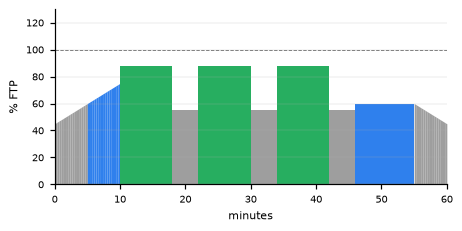

10 min warm-up, 3 x (8 min @ 88% / 4 min @ 55%), 9 min @ 60%, 5 min cool-down.

*Three blocks of 8 minutes. Aim for identical power on all three.*

#### Sweet Spot L03A - 2x15 @ 88%

**60 min - TSS 56 - Zwift 2.5/5** - [`SS_L03A_2x15_88.zwo`](Zwift/02_SweetSpot/SS_L03A_2x15_88.zwo) ([MyWhoosh version](MyWhoosh/02_SweetSpot/SS_L03A_2x15_88.zwo))

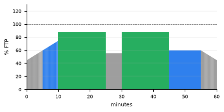

10 min warm-up, 15 min @ 88%, 5 min @ 55%, 15 min @ 88%, 10 min @ 60%, 5 min cool-down.

*Two 15-minute blocks. Break each one into three 5-minute chunks in your head.*

#### Sweet Spot L03B - 3x10 @ 88%

**60 min - TSS 55 - Zwift 2.5/5** - [`SS_L03B_3x10_88.zwo`](Zwift/02_SweetSpot/SS_L03B_3x10_88.zwo) ([MyWhoosh version](MyWhoosh/02_SweetSpot/SS_L03B_3x10_88.zwo))

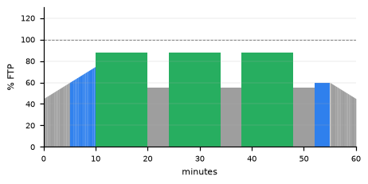

10 min warm-up, 3 x (10 min @ 88% / 4 min @ 55%), 3 min @ 60%, 5 min cool-down.

*30 minutes of sweet spot in three blocks.*

#### Sweet Spot L04A - 3x10 @ 90%

**60 min - TSS 57 - Zwift 2.5/5** - [`SS_L04A_3x10_90.zwo`](Zwift/02_SweetSpot/SS_L04A_3x10_90.zwo) ([MyWhoosh version](MyWhoosh/02_SweetSpot/SS_L04A_3x10_90.zwo))

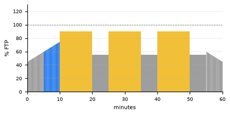

10 min warm-up, 3 x (10 min @ 90% / 5 min @ 55%), 5 min cool-down.

*The standard sweet spot intensity. If the third block drops by more than 3%, you started too hard.*

#### Sweet Spot L04B - 5x6 @ 90% short rest

**60 min - TSS 57 - Zwift 2.5/5** - [`SS_L04B_5x6_90_short_rest.zwo`](Zwift/02_SweetSpot/SS_L04B_5x6_90_short_rest.zwo) ([MyWhoosh version](MyWhoosh/02_SweetSpot/SS_L04B_5x6_90_short_rest.zwo))

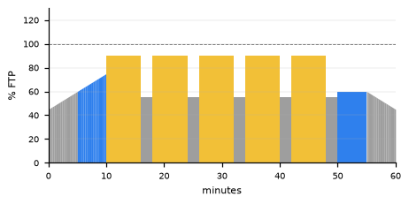

10 min warm-up, 5 x (6 min @ 90% / 2 min @ 55%), 5 min @ 60%, 5 min cool-down.

*Short 2-minute recoveries: fatigue accumulates, the last two blocks feel harder.*

#### Sweet Spot L05A - 2x16 @ 90%

**60 min - TSS 59 - Zwift 2.5/5** - [`SS_L05A_2x16_90.zwo`](Zwift/02_SweetSpot/SS_L05A_2x16_90.zwo) ([MyWhoosh version](MyWhoosh/02_SweetSpot/SS_L05A_2x16_90.zwo))

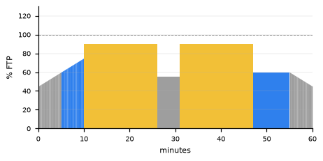

10 min warm-up, 16 min @ 90%, 5 min @ 55%, 16 min @ 90%, 8 min @ 60%, 5 min cool-down.

*Two 16-minute blocks. Keep the second identical to the first.*

#### Sweet Spot L05B - 4x8 @ 90%

**60 min - TSS 58 - Zwift 2.5/5** - [`SS_L05B_4x8_90.zwo`](Zwift/02_SweetSpot/SS_L05B_4x8_90.zwo) ([MyWhoosh version](MyWhoosh/02_SweetSpot/SS_L05B_4x8_90.zwo))


10 min warm-up, 4 x (8 min @ 90% / 3 min @ 55%), 6 min cool-down.

*Four blocks with 3-minute recoveries. Stay seated, power line flat.*

#### Sweet Spot L06A - 2x18 @ 90%

**60 min - TSS 62 - Zwift 3/5** - [`SS_L06A_2x18_90.zwo`](Zwift/02_SweetSpot/SS_L06A_2x18_90.zwo) ([MyWhoosh version](MyWhoosh/02_SweetSpot/SS_L06A_2x18_90.zwo))


10 min warm-up, 18 min @ 90%, 5 min @ 55%, 18 min @ 90%, 4 min @ 60%, 5 min cool-down.

*Two long blocks at 90%. Comfortably hard: you can speak a short sentence but would rather not.*

#### Sweet Spot L06B - 3x12 @ 90%

**60 min - TSS 62 - Zwift 3/5** - [`SS_L06B_3x12_90.zwo`](Zwift/02_SweetSpot/SS_L06B_3x12_90.zwo) ([MyWhoosh version](MyWhoosh/02_SweetSpot/SS_L06B_3x12_90.zwo))


10 min warm-up, 3 x (12 min @ 90% / 3 min @ 55%), 5 min cool-down.

*36 minutes of sweet spot in three blocks.*

#### Sweet Spot L07A - 3x12 @ 92%

**60 min - TSS 64 - Zwift 3/5** - [`SS_L07A_3x12_92.zwo`](Zwift/02_SweetSpot/SS_L07A_3x12_92.zwo) ([MyWhoosh version](MyWhoosh/02_SweetSpot/SS_L07A_3x12_92.zwo))


10 min warm-up, 3 x (12 min @ 92% / 3 min @ 55%), 5 min cool-down.

*Upper sweet spot. Focused but sustainable.*

#### Sweet Spot L07B - Over-Unders 3x12 (95/88)

**60 min - TSS 63 - Zwift 3/5** - [`SS_L07B_Over-Unders_3x12_95-88.zwo`](Zwift/02_SweetSpot/SS_L07B_Over-Unders_3x12_95-88.zwo) ([MyWhoosh version](MyWhoosh/02_SweetSpot/SS_L07B_Over-Unders_3x12_95-88.zwo))


10 min warm-up, 6 x (1 min @ 95% / 1 min @ 88%), 4 min @ 55%, 6 x (1 min @ 95% / 1 min @ 88%), 4 min @ 55%, 6 x (1 min @ 95% / 1 min @ 88%), 6 min cool-down.

*Alternate 1 min at 95% and 1 min at 88%. The under is still work - do not coast.*

#### Sweet Spot L08A - 3x12 @ 93%

**60 min - TSS 65 - Zwift 3.5/5** - [`SS_L08A_3x12_93.zwo`](Zwift/02_SweetSpot/SS_L08A_3x12_93.zwo) ([MyWhoosh version](MyWhoosh/02_SweetSpot/SS_L08A_3x12_93.zwo))


10 min warm-up, 3 x (12 min @ 93% / 3 min @ 55%), 5 min cool-down.

*Top of the sweet spot zone. The last block will feel close to threshold.*

#### Sweet Spot L08B - 2x18 @ 92%

**60 min - TSS 64 - Zwift 3.5/5** - [`SS_L08B_2x18_92.zwo`](Zwift/02_SweetSpot/SS_L08B_2x18_92.zwo) ([MyWhoosh version](MyWhoosh/02_SweetSpot/SS_L08B_2x18_92.zwo))


10 min warm-up, 18 min @ 92%, 5 min @ 55%, 18 min @ 92%, 4 min @ 60%, 5 min cool-down.

*Two long blocks at upper sweet spot. Check position every 5 minutes.*

#### Sweet Spot L09A - 2x20 @ 92%

**60 min - TSS 67 - Zwift 3.5/5** - [`SS_L09A_2x20_92.zwo`](Zwift/02_SweetSpot/SS_L09A_2x20_92.zwo) ([MyWhoosh version](MyWhoosh/02_SweetSpot/SS_L09A_2x20_92.zwo))


10 min warm-up, 20 min @ 92%, 5 min @ 55%, 20 min @ 92%, 5 min cool-down.

*The classic 2x20 at upper sweet spot. Patience and pacing.*

#### Sweet Spot L09B - 4x9 @ 94% short rest

**60 min - TSS 66 - Zwift 3.5/5** - [`SS_L09B_4x9_94_short_rest.zwo`](Zwift/02_SweetSpot/SS_L09B_4x9_94_short_rest.zwo) ([MyWhoosh version](MyWhoosh/02_SweetSpot/SS_L09B_4x9_94_short_rest.zwo))


10 min warm-up, 4 x (9 min @ 94% / 2:15 @ 55%), 5 min cool-down.

*Top of the zone with only 2.5-minute recoveries. Hard but repeatable.*

#### Sweet Spot L10A - 1x40 @ 92%

**60 min - TSS 68 - Zwift 3.5/5** - [`SS_L10A_1x40_92.zwo`](Zwift/02_SweetSpot/SS_L10A_1x40_92.zwo) ([MyWhoosh version](MyWhoosh/02_SweetSpot/SS_L10A_1x40_92.zwo))


10 min warm-up, 40 min @ 92%, 5 min @ 60%, 5 min cool-down.

*One continuous 40-minute block. Builds the durability of long climbs and time trials.*

#### Sweet Spot L10B - 3x13 @ 93%

**60 min - TSS 68 - Zwift 3.5/5** - [`SS_L10B_3x13_93.zwo`](Zwift/02_SweetSpot/SS_L10B_3x13_93.zwo) ([MyWhoosh version](MyWhoosh/02_SweetSpot/SS_L10B_3x13_93.zwo))


10 min warm-up, 3 x (13 min @ 93% / 2 min @ 55%), 5 min cool-down.

*39 minutes at the top of sweet spot. The hardest sweet spot session in the library.*

### Threshold - 60 min

95-105 % FTP. Raise FTP and hold long efforts at high intensity. Files: [`Zwift/03_Threshold`](Zwift/03_Threshold) - [`MyWhoosh/03_Threshold`](MyWhoosh/03_Threshold) - [back to index](#index)


#### Threshold L01A - 3x6 @ 95%

**60 min - TSS 51 - Zwift ~2/5** - [`THR_L01A_3x6_95.zwo`](Zwift/03_Threshold/THR_L01A_3x6_95.zwo) ([MyWhoosh version](MyWhoosh/03_Threshold/THR_L01A_3x6_95.zwo))


10 min warm-up, 3 x (6 min @ 95% / 4 min @ 55%), 15 min @ 60%, 5 min cool-down.

*Gentle introduction to threshold. Short blocks just under FTP.*

#### Threshold L01B - 2x8 @ 95%

**60 min - TSS 50 - Zwift ~2/5** - [`THR_L01B_2x8_95.zwo`](Zwift/03_Threshold/THR_L01B_2x8_95.zwo) ([MyWhoosh version](MyWhoosh/03_Threshold/THR_L01B_2x8_95.zwo))


10 min warm-up, 8 min @ 95%, 5 min @ 55%, 8 min @ 95%, 24 min @ 60%, 5 min cool-down.

*Two 8-minute blocks just under FTP. Start controlled.*

#### Threshold L02A - 2x10 @ 95%

**60 min - TSS 54 - Zwift ~2.5/5** - [`THR_L02A_2x10_95.zwo`](Zwift/03_Threshold/THR_L02A_2x10_95.zwo) ([MyWhoosh version](MyWhoosh/03_Threshold/THR_L02A_2x10_95.zwo))


10 min warm-up, 10 min @ 95%, 5 min @ 55%, 10 min @ 95%, 20 min @ 60%, 5 min cool-down.

*Two 10-minute blocks at 95%. Pace it like a time trial.*

#### Threshold L02B - 4x5 @ 96%

**60 min - TSS 54 - Zwift ~2.5/5** - [`THR_L02B_4x5_96.zwo`](Zwift/03_Threshold/THR_L02B_4x5_96.zwo) ([MyWhoosh version](MyWhoosh/03_Threshold/THR_L02B_4x5_96.zwo))


10 min warm-up, 4 x (5 min @ 96% / 3 min @ 55%), 13 min @ 60%, 5 min cool-down.

*Short repeated threshold efforts. Hit the number from the first minute.*

#### Threshold L03A - 2x12 @ 95%

**60 min - TSS 57 - Zwift ~2.5/5** - [`THR_L03A_2x12_95.zwo`](Zwift/03_Threshold/THR_L03A_2x12_95.zwo) ([MyWhoosh version](MyWhoosh/03_Threshold/THR_L03A_2x12_95.zwo))


10 min warm-up, 12 min @ 95%, 5 min @ 55%, 12 min @ 95%, 16 min @ 60%, 5 min cool-down.

*24 minutes just under threshold.*

#### Threshold L03B - 3x8 @ 96%

**60 min - TSS 57 - Zwift ~3/5** - [`THR_L03B_3x8_96.zwo`](Zwift/03_Threshold/THR_L03B_3x8_96.zwo) ([MyWhoosh version](MyWhoosh/03_Threshold/THR_L03B_3x8_96.zwo))


10 min warm-up, 3 x (8 min @ 96% / 4 min @ 55%), 9 min @ 60%, 5 min cool-down.

*Three 8-minute blocks with 4-minute recoveries.*

#### Threshold L04A - 3x8 @ 98%

**60 min - TSS 59 - Zwift ~3/5** - [`THR_L04A_3x8_98.zwo`](Zwift/03_Threshold/THR_L04A_3x8_98.zwo) ([MyWhoosh version](MyWhoosh/03_Threshold/THR_L04A_3x8_98.zwo))


10 min warm-up, 3 x (8 min @ 98% / 4 min @ 55%), 9 min @ 60%, 5 min cool-down.

*Three blocks very close to FTP. The first 3 minutes should feel too easy.*

#### Threshold L04B - 2x12 @ 98%

**60 min - TSS 60 - Zwift ~3/5** - [`THR_L04B_2x12_98.zwo`](Zwift/03_Threshold/THR_L04B_2x12_98.zwo) ([MyWhoosh version](MyWhoosh/03_Threshold/THR_L04B_2x12_98.zwo))


10 min warm-up, 12 min @ 98%, 5 min @ 55%, 12 min @ 98%, 16 min @ 60%, 5 min cool-down.

*Two 12-minute blocks at 98%. Breathe deep and stay smooth.*

#### Threshold L05A - 3x9 @ 97%

**60 min - TSS 61 - Zwift 3/5** - [`THR_L05A_3x9_97.zwo`](Zwift/03_Threshold/THR_L05A_3x9_97.zwo) ([MyWhoosh version](MyWhoosh/03_Threshold/THR_L05A_3x9_97.zwo))


10 min warm-up, 3 x (9 min @ 97% / 4 min @ 55%), 6 min @ 60%, 5 min cool-down.

*27 minutes of threshold in three blocks.*

#### Threshold L05B - Over-Unders 3x9 (93/105)

**60 min - TSS 61 - Zwift 3/5** - [`THR_L05B_Over-Unders_3x9_93-105.zwo`](Zwift/03_Threshold/THR_L05B_Over-Unders_3x9_93-105.zwo) ([MyWhoosh version](MyWhoosh/03_Threshold/THR_L05B_Over-Unders_3x9_93-105.zwo))


10 min warm-up, 3 x (2 min @ 93% / 1 min @ 105%), 5 min @ 55%, 3 x (2 min @ 93% / 1 min @ 105%), 5 min @ 55%, 3 x (2 min @ 93% / 1 min @ 105%), 8 min @ 60%, 5 min cool-down.

*2 min under at 93%, 1 min over at 105%. Never coast after an over.*

#### Threshold L06A - 2x15 @ 97%

**60 min - TSS 65 - Zwift 3.5/5** - [`THR_L06A_2x15_97.zwo`](Zwift/03_Threshold/THR_L06A_2x15_97.zwo) ([MyWhoosh version](MyWhoosh/03_Threshold/THR_L06A_2x15_97.zwo))


10 min warm-up, 15 min @ 97%, 5 min @ 55%, 15 min @ 97%, 10 min @ 60%, 5 min cool-down.

*Two 15-minute blocks. Time-trial pacing: the first 5 minutes feel easy.*

#### Threshold L06B - 3x10 @ 98%

**60 min - TSS 65 - Zwift 3.5/5** - [`THR_L06B_3x10_98.zwo`](Zwift/03_Threshold/THR_L06B_3x10_98.zwo) ([MyWhoosh version](MyWhoosh/03_Threshold/THR_L06B_3x10_98.zwo))


10 min warm-up, 3 x (10 min @ 98% / 4 min @ 55%), 3 min @ 60%, 5 min cool-down.

*Three 10-minute blocks at 98%.*

#### Threshold L07A - 3x10 @ 100%

**60 min - TSS 67 - Zwift 3.5/5** - [`THR_L07A_3x10_100.zwo`](Zwift/03_Threshold/THR_L07A_3x10_100.zwo) ([MyWhoosh version](MyWhoosh/03_Threshold/THR_L07A_3x10_100.zwo))


10 min warm-up, 3 x (10 min @ 100% / 5 min @ 55%), 5 min cool-down.

*30 minutes at FTP. If you cannot finish the third block, your FTP is set too high.*

#### Threshold L07B - 5x5 @ 105%

**60 min - TSS 67 - Zwift 4/5** - [`THR_L07B_5x5_105.zwo`](Zwift/03_Threshold/THR_L07B_5x5_105.zwo) ([MyWhoosh version](MyWhoosh/03_Threshold/THR_L07B_5x5_105.zwo))


10 min warm-up, 5 x (5 min @ 105% / 4 min @ 60%), 5 min cool-down.

*Five 5-minute blocks above threshold. Repeatability matters more than any single block.*

#### Threshold L08A - 2x18 @ 98%

**60 min - TSS 72 - Zwift 4/5** - [`THR_L08A_2x18_98.zwo`](Zwift/03_Threshold/THR_L08A_2x18_98.zwo) ([MyWhoosh version](MyWhoosh/03_Threshold/THR_L08A_2x18_98.zwo))


10 min warm-up, 18 min @ 98%, 5 min @ 55%, 18 min @ 98%, 4 min @ 60%, 5 min cool-down.

*Two long blocks just under FTP. Mentally commit before the second one.*

#### Threshold L08B - 4x8 @ 102%

**60 min - TSS 71 - Zwift 4/5** - [`THR_L08B_4x8_102.zwo`](Zwift/03_Threshold/THR_L08B_4x8_102.zwo) ([MyWhoosh version](MyWhoosh/03_Threshold/THR_L08B_4x8_102.zwo))


10 min warm-up, 4 x (8 min @ 102% / 3:15 @ 55%), 5 min cool-down.

*Four blocks just above FTP. The burn builds from minute 4 - stay seated.*

#### Threshold L09A - 3x12 @ 100%

**60 min - TSS 74 - Zwift 4.5/5** - [`THR_L09A_3x12_100.zwo`](Zwift/03_Threshold/THR_L09A_3x12_100.zwo) ([MyWhoosh version](MyWhoosh/03_Threshold/THR_L09A_3x12_100.zwo))


10 min warm-up, 3 x (12 min @ 100% / 3 min @ 55%), 5 min cool-down.

*36 minutes at FTP. A benchmark session - fuel before and during.*

#### Threshold L09B - 2x20 @ 97%

**60 min - TSS 74 - Zwift 4.5/5** - [`THR_L09B_2x20_97.zwo`](Zwift/03_Threshold/THR_L09B_2x20_97.zwo) ([MyWhoosh version](MyWhoosh/03_Threshold/THR_L09B_2x20_97.zwo))


10 min warm-up, 20 min @ 97%, 5 min @ 55%, 20 min @ 97%, 5 min cool-down.

*The classic 2x20 just under threshold. Patience in the first 10 minutes.*

#### Threshold L10A - 2x20 @ 100%

**60 min - TSS 78 - Zwift 4.5/5** - [`THR_L10A_2x20_100.zwo`](Zwift/03_Threshold/THR_L10A_2x20_100.zwo) ([MyWhoosh version](MyWhoosh/03_Threshold/THR_L10A_2x20_100.zwo))


10 min warm-up, 20 min @ 100%, 5 min @ 55%, 20 min @ 100%, 5 min cool-down.

*The reference threshold workout: 40 minutes at FTP. Only when fresh.*

#### Threshold L10B - 3x13 @ 100% short rest

**60 min - TSS 77 - Zwift 4.5/5** - [`THR_L10B_3x13_100_short_rest.zwo`](Zwift/03_Threshold/THR_L10B_3x13_100_short_rest.zwo) ([MyWhoosh version](MyWhoosh/03_Threshold/THR_L10B_3x13_100_short_rest.zwo))


10 min warm-up, 3 x (13 min @ 100% / 2 min @ 55%), 5 min cool-down.

*39 minutes at FTP with only 3-minute recoveries. The hardest threshold session in the library.*

### VO2max - 60 min

106-120 % FTP. Develop maximal aerobic power. Never two days in a row. Files: [`Zwift/04_VO2max`](Zwift/04_VO2max) - [`MyWhoosh/04_VO2max`](MyWhoosh/04_VO2max) - [back to index](#index)


#### VO2max L01A - 4x3 @ 108%

**60 min - TSS 48 - Zwift 2.5/5** - [`VO2_L01A_4x3_108.zwo`](Zwift/04_VO2max/VO2_L01A_4x3_108.zwo) ([MyWhoosh version](MyWhoosh/04_VO2max/VO2_L01A_4x3_108.zwo))


12 min warm-up, 4 x (3 min @ 108% / 3 min @ 50%), 16 min @ 60%, 8 min cool-down.

*Gentle introduction to VO2max work. Breathing should be hard by the end of each interval.*

#### VO2max L01B - 10x1 @ 115%

**60 min - TSS 48 - Zwift 2/5** - [`VO2_L01B_10x1_115.zwo`](Zwift/04_VO2max/VO2_L01B_10x1_115.zwo) ([MyWhoosh version](MyWhoosh/04_VO2max/VO2_L01B_10x1_115.zwo))


12 min warm-up, 10 x (1 min @ 115% / 1:30 @ 50%), 15 min @ 60%, 8 min cool-down.

*Short, sharp efforts with 90 s recovery. Commit from the first pedal stroke.*

#### VO2max L02A - 5x3 @ 108%

**60 min - TSS 52 - Zwift 2.5/5** - [`VO2_L02A_5x3_108.zwo`](Zwift/04_VO2max/VO2_L02A_5x3_108.zwo) ([MyWhoosh version](MyWhoosh/04_VO2max/VO2_L02A_5x3_108.zwo))


12 min warm-up, 5 x (3 min @ 108% / 3 min @ 50%), 10 min @ 60%, 8 min cool-down.

*Five 3-minute intervals. Go out fast and settle - no fade in the last minute.*

#### VO2max L02B - 6x2 @ 115%

**60 min - TSS 51 - Zwift 2.5/5** - [`VO2_L02B_6x2_115.zwo`](Zwift/04_VO2max/VO2_L02B_6x2_115.zwo) ([MyWhoosh version](MyWhoosh/04_VO2max/VO2_L02B_6x2_115.zwo))


12 min warm-up, 6 x (2 min @ 115% / 2 min @ 50%), 16 min @ 60%, 8 min cool-down.

*Six 2-minute efforts with equal recovery. Short enough to go hard.*

#### VO2max L03A - 4x4 @ 108%

**60 min - TSS 53 - Zwift 3/5** - [`VO2_L03A_4x4_108.zwo`](Zwift/04_VO2max/VO2_L03A_4x4_108.zwo) ([MyWhoosh version](MyWhoosh/04_VO2max/VO2_L03A_4x4_108.zwo))


12 min warm-up, 4 x (4 min @ 108% / 4 min @ 50%), 8 min @ 60%, 8 min cool-down.

*Four 4-minute intervals at the bottom of the VO2 zone. Pace the first minute.*

#### VO2max L03B - 5x3 @ 112%

**60 min - TSS 54 - Zwift 3/5** - [`VO2_L03B_5x3_112.zwo`](Zwift/04_VO2max/VO2_L03B_5x3_112.zwo) ([MyWhoosh version](MyWhoosh/04_VO2max/VO2_L03B_5x3_112.zwo))


12 min warm-up, 5 x (3 min @ 112% / 3 min @ 50%), 10 min @ 60%, 8 min cool-down.

*Five 3-minute intervals at 112%.*

#### VO2max L04A - 4x4 @ 115%

**60 min - TSS 57 - Zwift 3.5/5** - [`VO2_L04A_4x4_115.zwo`](Zwift/04_VO2max/VO2_L04A_4x4_115.zwo) ([MyWhoosh version](MyWhoosh/04_VO2max/VO2_L04A_4x4_115.zwo))


12 min warm-up, 4 x (4 min @ 115% / 4 min @ 50%), 8 min @ 60%, 8 min cool-down.

*Four 4-minute intervals at 115%. Aim to reach maximal breathing within 90 s.*

#### VO2max L04B - 30/30 3x10 (120/50)

**60 min - TSS 58 - Zwift 3/5** - [`VO2_L04B_30-30_3x10_120-50.zwo`](Zwift/04_VO2max/VO2_L04B_30-30_3x10_120-50.zwo) ([MyWhoosh version](MyWhoosh/04_VO2max/VO2_L04B_30-30_3x10_120-50.zwo))


12 min warm-up, 10 x (30 s @ 120% / 30 s @ 50%), 5 min @ 55%, 10 x (30 s @ 120% / 30 s @ 50%), 5 min @ 55%, 10 x (30 s @ 120% / 30 s @ 50%), 8 min cool-down.

*Three sets of ten 30/30s. The off is soft-pedalling, not stopping.*

#### VO2max L05A - 5x4 @ 110%

**60 min - TSS 59 - Zwift 3.5/5** - [`VO2_L05A_5x4_110.zwo`](Zwift/04_VO2max/VO2_L05A_5x4_110.zwo) ([MyWhoosh version](MyWhoosh/04_VO2max/VO2_L05A_5x4_110.zwo))


12 min warm-up, 5 x (4 min @ 110% / 4 min @ 50%), 8 min cool-down.

*Five 4-minute intervals at 110%. Control the first 2 minutes.*

#### VO2max L05B - 4x5 @ 110%

**60 min - TSS 59 - Zwift 3.5/5** - [`VO2_L05B_4x5_110.zwo`](Zwift/04_VO2max/VO2_L05B_4x5_110.zwo) ([MyWhoosh version](MyWhoosh/04_VO2max/VO2_L05B_4x5_110.zwo))


12 min warm-up, 4 x (5 min @ 110% / 5 min @ 50%), 8 min cool-down.

*Four 5-minute intervals. Long VO2 work - the last 90 s of each is a fight.*

#### VO2max L06A - 5x4 @ 112%

**60 min - TSS 61 - Zwift 3.5/5** - [`VO2_L06A_5x4_112.zwo`](Zwift/04_VO2max/VO2_L06A_5x4_112.zwo) ([MyWhoosh version](MyWhoosh/04_VO2max/VO2_L06A_5x4_112.zwo))


12 min warm-up, 5 x (4 min @ 112% / 4 min @ 50%), 8 min cool-down.

*Five 4-minute intervals at 112%.*

#### VO2max L06B - 6x3 @ 115%

**60 min - TSS 60 - Zwift 3.5/5** - [`VO2_L06B_6x3_115.zwo`](Zwift/04_VO2max/VO2_L06B_6x3_115.zwo) ([MyWhoosh version](MyWhoosh/04_VO2max/VO2_L06B_6x3_115.zwo))


12 min warm-up, 6 x (3 min @ 115% / 3 min @ 50%), 4 min @ 60%, 8 min cool-down.

*Six 3-minute intervals at 115%. Fast start, then hold.*

#### VO2max L07A - 5x4 @ 115%

**60 min - TSS 63 - Zwift ~4/5** - [`VO2_L07A_5x4_115.zwo`](Zwift/04_VO2max/VO2_L07A_5x4_115.zwo) ([MyWhoosh version](MyWhoosh/04_VO2max/VO2_L07A_5x4_115.zwo))


12 min warm-up, 5 x (4 min @ 115% / 4 min @ 50%), 8 min cool-down.

*The classic VO2max session. If you fail the 4th, lower the bias by 3% rather than skipping the 5th.*

#### VO2max L07B - 40/20 3x8 (125/50)

**60 min - TSS 64 - Zwift ~3.5/5** - [`VO2_L07B_40-20_3x8_125-50.zwo`](Zwift/04_VO2max/VO2_L07B_40-20_3x8_125-50.zwo) ([MyWhoosh version](MyWhoosh/04_VO2max/VO2_L07B_40-20_3x8_125-50.zwo))


12 min warm-up, 8 x (40 s @ 125% / 20 s @ 50%), 5 min @ 55%, 8 x (40 s @ 125% / 20 s @ 50%), 5 min @ 55%, 8 x (40 s @ 125% / 20 s @ 50%), 6 min @ 60%, 8 min cool-down.

*Three sets of eight 40/20s. The 20 s rest is too short to recover - that is the point.*

#### VO2max L08A - 6x4 @ 112%

**60 min - TSS 67 - Zwift ~4.5/5** - [`VO2_L08A_6x4_112.zwo`](Zwift/04_VO2max/VO2_L08A_6x4_112.zwo) ([MyWhoosh version](MyWhoosh/04_VO2max/VO2_L08A_6x4_112.zwo))


10 min warm-up, 6 x (4 min @ 112% / 3 min @ 50%), 2 min @ 60%, 6 min cool-down.

*Six 4-minute intervals with 3-minute recoveries. Repeatability is the goal.*

#### VO2max L08B - 30/15 3x13 (120/50)

**60 min - TSS 67 - Zwift ~3.5/5** - [`VO2_L08B_30-15_3x13_120-50.zwo`](Zwift/04_VO2max/VO2_L08B_30-15_3x13_120-50.zwo) ([MyWhoosh version](MyWhoosh/04_VO2max/VO2_L08B_30-15_3x13_120-50.zwo))


12 min warm-up, 13 x (30 s @ 120% / 15 s @ 50%), 4 min @ 55%, 13 x (30 s @ 120% / 15 s @ 50%), 4 min @ 55%, 13 x (30 s @ 120% / 15 s @ 50%), 2:45 @ 60%, 8 min cool-down.

*Ronnestad protocol: three sets of thirteen 30/15s. Heart rate climbs steadily and stays near max.*

#### VO2max L09A - 5x5 @ 112%

**60 min - TSS 69 - Zwift ~4.5/5** - [`VO2_L09A_5x5_112.zwo`](Zwift/04_VO2max/VO2_L09A_5x5_112.zwo) ([MyWhoosh version](MyWhoosh/04_VO2max/VO2_L09A_5x5_112.zwo))


10 min warm-up, 5 x (5 min @ 112% / 3:30 @ 50%), 1:30 @ 60%, 6 min cool-down.

*Five 5-minute intervals with short recoveries. A big VO2max dose.*

#### VO2max L09B - Hard-Start 6x4 (140 then 110)

**60 min - TSS 70 - Zwift ~4.5/5** - [`VO2_L09B_Hard-Start_6x4_140_then_110.zwo`](Zwift/04_VO2max/VO2_L09B_Hard-Start_6x4_140_then_110.zwo) ([MyWhoosh version](MyWhoosh/04_VO2max/VO2_L09B_Hard-Start_6x4_140_then_110.zwo))


10 min warm-up, 30 s @ 140%, 3:30 @ 110%, 3 min @ 50%, 30 s @ 140%, 3:30 @ 110%, 3 min @ 50%, 30 s @ 140%, 3:30 @ 110%, 3 min @ 50%, 30 s @ 140%, 3:30 @ 110%, 3 min @ 50%, 30 s @ 140%, 3:30 @ 110%, 3 min @ 50%, 30 s @ 140%, 3:30 @ 110%, 5 min @ 60%, 6 min cool-down.

*30 s at 140% then 3:30 at 110%. The hard start drives oxygen uptake up fast; the 110% part feels much harder than usual.*

#### VO2max L10A - 6x4 @ 118%

**60 min - TSS 73 - Zwift ~5/5** - [`VO2_L10A_6x4_118.zwo`](Zwift/04_VO2max/VO2_L10A_6x4_118.zwo) ([MyWhoosh version](MyWhoosh/04_VO2max/VO2_L10A_6x4_118.zwo))


10 min warm-up, 6 x (4 min @ 118% / 3 min @ 50%), 2 min @ 60%, 6 min cool-down.

*Six 4-minute intervals at 118% with 3-minute recoveries. The hardest VO2max session in the library.*

#### VO2max L10B - Ramped 6x4 (110 to 125)

**60 min - TSS 73 - Zwift ~5/5** - [`VO2_L10B_Ramped_6x4_110_to_125.zwo`](Zwift/04_VO2max/VO2_L10B_Ramped_6x4_110_to_125.zwo) ([MyWhoosh version](MyWhoosh/04_VO2max/VO2_L10B_Ramped_6x4_110_to_125.zwo))


10 min warm-up, 4 min ramp 110% to 125%, 3 min @ 50%, 4 min ramp 110% to 125%, 3 min @ 50%, 4 min ramp 110% to 125%, 3 min @ 50%, 4 min ramp 110% to 125%, 3 min @ 50%, 4 min ramp 110% to 125%, 3 min @ 50%, 4 min ramp 110% to 125%, 5 min @ 60%, 6 min cool-down.

*Each interval ramps from 110% to 125%: it finishes at its hardest. Mentally prepare for the final minute.*

### Mixed - 60 min

Combined sessions: race simulations, zone pyramids, sprints. Files: [`Zwift/05_Mixed`](Zwift/05_Mixed) - [`MyWhoosh/05_Mixed`](MyWhoosh/05_Mixed) - [back to index](#index)


#### Mixed L01A - Z2 + 4x1 @ 120%

**60 min - TSS 47 - Zwift ~2/5** - [`MIX_L01A_Z2_plus_4x1_120.zwo`](Zwift/05_Mixed/MIX_L01A_Z2_plus_4x1_120.zwo) ([MyWhoosh version](MyWhoosh/05_Mixed/MIX_L01A_Z2_plus_4x1_120.zwo))


10 min warm-up, 15 min @ 68%, 4 x (1 min @ 120% / 4 min @ 60%), 10 min @ 68%, 5 min cool-down.

*Zone 2 with four 1-minute efforts. Full gas, then straight back to easy.*

#### Mixed L01B - Z2 + 6 Sprints

**60 min - TSS 45 - Zwift ~1.5/5** - [`MIX_L01B_Z2_plus_6_Sprints.zwo`](Zwift/05_Mixed/MIX_L01B_Z2_plus_6_Sprints.zwo) ([MyWhoosh version](MyWhoosh/05_Mixed/MIX_L01B_Z2_plus_6_Sprints.zwo))


10 min warm-up, 10 min @ 68%, 6 x (10 s @ 160% / 4:50 @ 66%), 5 min @ 68%, 5 min cool-down.

*Zone 2 with six 10-second all-out sprints and full recovery. The 160% target is a floor - beat it.*

#### Mixed L02A - Z2 + Tempo Finish

**60 min - TSS 50 - Zwift ~2/5** - [`MIX_L02A_Z2_plus_Tempo_Finish.zwo`](Zwift/05_Mixed/MIX_L02A_Z2_plus_Tempo_Finish.zwo) ([MyWhoosh version](MyWhoosh/05_Mixed/MIX_L02A_Z2_plus_Tempo_Finish.zwo))


10 min warm-up, 30 min @ 68%, 15 min @ 85%, 5 min cool-down.

*30 min Zone 2 then 15 min tempo. Finish stronger than you started.*

#### Mixed L02B - Tempo 3x8 @ 82% + Sprints

**60 min - TSS 49 - Zwift ~2/5** - [`MIX_L02B_Tempo_3x8_82_plus_Sprints.zwo`](Zwift/05_Mixed/MIX_L02B_Tempo_3x8_82_plus_Sprints.zwo) ([MyWhoosh version](MyWhoosh/05_Mixed/MIX_L02B_Tempo_3x8_82_plus_Sprints.zwo))


10 min warm-up, 7:50 @ 82%, 10 s @ 160%, 4 min @ 55%, 7:50 @ 82%, 10 s @ 160%, 4 min @ 55%, 7:50 @ 82%, 10 s @ 160%, 13 min @ 60%, 5 min cool-down.

*Each tempo block ends with a 10-second sprint on tired legs - like a race finish.*

#### Mixed L03A - Tempo 3x10 @ 82% + Sprints

**60 min - TSS 52 - Zwift ~2/5** - [`MIX_L03A_Tempo_3x10_82_plus_Sprints.zwo`](Zwift/05_Mixed/MIX_L03A_Tempo_3x10_82_plus_Sprints.zwo) ([MyWhoosh version](MyWhoosh/05_Mixed/MIX_L03A_Tempo_3x10_82_plus_Sprints.zwo))


10 min warm-up, 9:50 @ 82%, 10 s @ 160%, 4 min @ 55%, 9:50 @ 82%, 10 s @ 160%, 4 min @ 55%, 9:50 @ 82%, 10 s @ 160%, 7 min @ 60%, 5 min cool-down.

*Three 10-minute tempo blocks, each ending in a sprint. Shift up one gear before you go.*

#### Mixed L03B - Z2 + 4x1 @ 130%

**60 min - TSS 51 - Zwift ~2.5/5** - [`MIX_L03B_Z2_plus_4x1_130.zwo`](Zwift/05_Mixed/MIX_L03B_Z2_plus_4x1_130.zwo) ([MyWhoosh version](MyWhoosh/05_Mixed/MIX_L03B_Z2_plus_4x1_130.zwo))


10 min warm-up, 15 min @ 72%, 4 x (1 min @ 130% / 4 min @ 60%), 10 min @ 72%, 5 min cool-down.

*Zone 2 with four 1-minute anaerobic efforts at 130%. The ride stays aerobic overall.*

#### Mixed L04A - Sweet Spot 2x10 + 3x1 @ 120%

**60 min - TSS 54 - Zwift ~2.5/5** - [`MIX_L04A_Sweet_Spot_2x10_plus_3x1_120.zwo`](Zwift/05_Mixed/MIX_L04A_Sweet_Spot_2x10_plus_3x1_120.zwo) ([MyWhoosh version](MyWhoosh/05_Mixed/MIX_L04A_Sweet_Spot_2x10_plus_3x1_120.zwo))


10 min warm-up, 10 min @ 90%, 4 min @ 55%, 10 min @ 90%, 4 min @ 55%, 3 x (1 min @ 120% / 2 min @ 50%), 8 min @ 60%, 5 min cool-down.

*Sweet spot base then three short VO2 efforts on pre-fatigued legs.*

#### Mixed L04B - Descending 92 / 88 / 84%

**60 min - TSS 55 - Zwift ~2.5/5** - [`MIX_L04B_Descending_92_-_88_-_84.zwo`](Zwift/05_Mixed/MIX_L04B_Descending_92_-_88_-_84.zwo) ([MyWhoosh version](MyWhoosh/05_Mixed/MIX_L04B_Descending_92_-_88_-_84.zwo))


10 min warm-up, 10 min @ 92%, 4 min @ 55%, 10 min @ 88%, 4 min @ 55%, 10 min @ 84%, 7 min @ 60%, 5 min cool-down.

*Three 10-minute blocks of descending intensity. Each feels similar as fatigue builds.*

#### Mixed L05A - Light Over-Unders 3x10 (95/85)

**60 min - TSS 57 - Zwift ~2.5/5** - [`MIX_L05A_Light_Over-Unders_3x10_95-85.zwo`](Zwift/05_Mixed/MIX_L05A_Light_Over-Unders_3x10_95-85.zwo) ([MyWhoosh version](MyWhoosh/05_Mixed/MIX_L05A_Light_Over-Unders_3x10_95-85.zwo))


10 min warm-up, 5 x (1 min @ 95% / 1 min @ 85%), 4 min @ 55%, 5 x (1 min @ 95% / 1 min @ 85%), 4 min @ 55%, 5 x (1 min @ 95% / 1 min @ 85%), 7 min @ 60%, 5 min cool-down.

*Gentle introduction to over-unders. Change only the gear between phases.*

#### Mixed L05B - Zone Ladder Tempo-SS-Threshold

**60 min - TSS 57 - Zwift ~2.5/5** - [`MIX_L05B_Zone_Ladder_Tempo-SS-Threshold.zwo`](Zwift/05_Mixed/MIX_L05B_Zone_Ladder_Tempo-SS-Threshold.zwo) ([MyWhoosh version](MyWhoosh/05_Mixed/MIX_L05B_Zone_Ladder_Tempo-SS-Threshold.zwo))


10 min warm-up, 10 min @ 85%, 4 min @ 55%, 10 min @ 90%, 4 min @ 55%, 8 min @ 100%, 9 min @ 60%, 5 min cool-down.

*10 min tempo, 10 min sweet spot, 8 min threshold. Each step changes the sensation.*

#### Mixed L06A - Sweet Spot 2x10 + 4x2 @ 118%

**60 min - TSS 62 - Zwift ~3.5/5** - [`MIX_L06A_Sweet_Spot_2x10_plus_4x2_118.zwo`](Zwift/05_Mixed/MIX_L06A_Sweet_Spot_2x10_plus_4x2_118.zwo) ([MyWhoosh version](MyWhoosh/05_Mixed/MIX_L06A_Sweet_Spot_2x10_plus_4x2_118.zwo))


10 min warm-up, 10 min @ 90%, 4 min @ 55%, 10 min @ 90%, 5 min @ 55%, 4 x (2 min @ 118% / 2 min @ 50%), 5 min cool-down.

*Aerobic base then top-end. Do not overcook the first VO2 interval.*

#### Mixed L06B - Climb Simulation 20 + 12

**60 min - TSS 62 - Zwift ~3/5** - [`MIX_L06B_Climb_Simulation_20_plus_12.zwo`](Zwift/05_Mixed/MIX_L06B_Climb_Simulation_20_plus_12.zwo) ([MyWhoosh version](MyWhoosh/05_Mixed/MIX_L06B_Climb_Simulation_20_plus_12.zwo))


10 min warm-up, 4 min @ 90%, 30 s @ 115%, 4:30 @ 90%, 30 s @ 115%, 4:30 @ 90%, 30 s @ 115%, 5:30 @ 90%, 6 min @ 55%, 3:30 @ 92%, 30 s @ 120%, 3:30 @ 92%, 30 s @ 120%, 4 min @ 92%, 7 min @ 60%, 5 min cool-down.

*Two simulated climbs at sweet spot with 30-second surges. Settle back without losing power.*

#### Mixed L07A - Zone Pyramid Tempo-THR-VO2-THR-Tempo

**60 min - TSS 63 - Zwift ~3.5/5** - [`MIX_L07A_Zone_Pyramid_Tempo-THR-VO2-THR-Tempo.zwo`](Zwift/05_Mixed/MIX_L07A_Zone_Pyramid_Tempo-THR-VO2-THR-Tempo.zwo) ([MyWhoosh version](MyWhoosh/05_Mixed/MIX_L07A_Zone_Pyramid_Tempo-THR-VO2-THR-Tempo.zwo))


10 min warm-up, 7 min @ 85%, 4 min @ 60%, 7 min @ 100%, 4 min @ 55%, 4 min @ 115%, 4 min @ 55%, 7 min @ 100%, 3 min @ 60%, 5 min @ 85%, 5 min cool-down.

*Tempo, threshold, VO2max and back down. Notice how each zone feels different.*

#### Mixed L07B - Anaerobic 20/40 x2 + Sweet Spot

**60 min - TSS 63 - Zwift ~3/5** - [`MIX_L07B_Anaerobic_20-40_x2_plus_Sweet_Spot.zwo`](Zwift/05_Mixed/MIX_L07B_Anaerobic_20-40_x2_plus_Sweet_Spot.zwo) ([MyWhoosh version](MyWhoosh/05_Mixed/MIX_L07B_Anaerobic_20-40_x2_plus_Sweet_Spot.zwo))


10 min warm-up, 3 min @ 70%, 8 x (20 s @ 150% / 40 s @ 50%), 5 min @ 55%, 8 x (20 s @ 150% / 40 s @ 50%), 5 min @ 55%, 16 min @ 92%, 5 min cool-down.

*Two sets of eight 20/40s at 150%, then 16 minutes of sweet spot on tired legs.*

#### Mixed L08A - Race Simulation

**60 min - TSS 65 - Zwift ~4/5** - [`MIX_L08A_Race_Simulation.zwo`](Zwift/05_Mixed/MIX_L08A_Race_Simulation.zwo) ([MyWhoosh version](MyWhoosh/05_Mixed/MIX_L08A_Race_Simulation.zwo))


10 min warm-up, 5 min @ 72%, 1 min @ 140%, 3 min @ 105%, 5 min @ 88%, 1:30 @ 130%, 8 min @ 97%, 4 min @ 65%, 30 s @ 150%, 2:30 @ 102%, 4 min @ 65%, 1 min @ 120%, 20 s @ 160%, 4:40 @ 50%, 4:30 @ 60%, 5 min cool-down.

*Neutral rollout, attack, chase, breakaway, counter, lead-out, sprint. React to each cue immediately.*

#### Mixed L08B - Over-Under Pyramid 4-6-8-6-4

**60 min - TSS 65 - Zwift ~3.5/5** - [`MIX_L08B_Over-Under_Pyramid_4-6-8-6-4.zwo`](Zwift/05_Mixed/MIX_L08B_Over-Under_Pyramid_4-6-8-6-4.zwo) ([MyWhoosh version](MyWhoosh/05_Mixed/MIX_L08B_Over-Under_Pyramid_4-6-8-6-4.zwo))


10 min warm-up, 2 x (1 min @ 105% / 1 min @ 90%), 3 min @ 55%, 3 x (1 min @ 110% / 1 min @ 90%), 3 min @ 55%, 4 x (1 min @ 115% / 1 min @ 90%), 3 min @ 55%, 3 x (1 min @ 110% / 1 min @ 90%), 3 min @ 55%, 2 x (1 min @ 105% / 1 min @ 90%), 5 min @ 60%, 5 min cool-down.

*Overs rise from 105% to 115% at the peak, unders at 90%. The 8-minute block is the crux.*

#### Mixed L09A - Kitchen Sink

**60 min - TSS 67 - Zwift ~4/5** - [`MIX_L09A_Kitchen_Sink.zwo`](Zwift/05_Mixed/MIX_L09A_Kitchen_Sink.zwo) ([MyWhoosh version](MyWhoosh/05_Mixed/MIX_L09A_Kitchen_Sink.zwo))


10 min warm-up, 10 min @ 92%, 3 min @ 55%, 8 min @ 102%, 3 min @ 55%, 4 x (2 min @ 118% / 2 min @ 50%), 30 s @ 55%, 3 x (15 s @ 160% / 1:15 @ 55%), 5 min cool-down.

*Sweet spot, threshold, VO2max and sprints in one hour. Intensity rises as duration falls.*

#### Mixed L09B - Threshold 2x10 @ 102% + 3x2 @ 120%

**60 min - TSS 67 - Zwift ~4/5** - [`MIX_L09B_Threshold_2x10_102_plus_3x2_120.zwo`](Zwift/05_Mixed/MIX_L09B_Threshold_2x10_102_plus_3x2_120.zwo) ([MyWhoosh version](MyWhoosh/05_Mixed/MIX_L09B_Threshold_2x10_102_plus_3x2_120.zwo))


10 min warm-up, 10 min @ 102%, 4 min @ 55%, 10 min @ 102%, 4 min @ 55%, 3 x (2 min @ 120% / 2 min @ 50%), 5 min @ 60%, 5 min cool-down.

*Supra-threshold first, then VO2max on tired legs. Save something for the 2-minute efforts.*

#### Mixed L10A - Threshold 2x8 + 4x3 @ 118%

**60 min - TSS 71 - Zwift ~4.5/5** - [`MIX_L10A_Threshold_2x8_plus_4x3_118.zwo`](Zwift/05_Mixed/MIX_L10A_Threshold_2x8_plus_4x3_118.zwo) ([MyWhoosh version](MyWhoosh/05_Mixed/MIX_L10A_Threshold_2x8_plus_4x3_118.zwo))


10 min warm-up, 8 min @ 100%, 4 min @ 55%, 8 min @ 100%, 3 min @ 55%, 4 x (3 min @ 118% / 2:30 @ 50%), 5 min cool-down.

*Threshold then a full VO2max set. The hardest mixed session - only when fresh and fuelled.*

#### Mixed L10B - Hard Race Simulation

**60 min - TSS 71 - Zwift ~4.5/5** - [`MIX_L10B_Hard_Race_Simulation.zwo`](Zwift/05_Mixed/MIX_L10B_Hard_Race_Simulation.zwo) ([MyWhoosh version](MyWhoosh/05_Mixed/MIX_L10B_Hard_Race_Simulation.zwo))


10 min warm-up, 4 min @ 75%, 1 min @ 145%, 3 min @ 105%, 5 min @ 90%, 1:30 @ 130%, 8 min @ 100%, 5 min @ 65%, 30 s @ 155%, 3 min @ 102%, 3 min @ 65%, 30 s @ 150%, 2 min @ 98%, 2 min @ 65%, 1 min @ 125%, 20 s @ 160%, 5:10 @ 50%, 5 min cool-down.

*A race that never lets up: longer break, harder attacks, two sprints. Treat every cue like it decides the race.*

### Over-Unders - 60 min

Alternating under / over threshold without rest. Lactate clearance, very effective for raising FTP. One per week at most, never the day before a VO2max session, and only once Sweet Spot L04-L05 feels comfortable. Files: [`Zwift/06_OverUnders`](Zwift/06_OverUnders) - [`MyWhoosh/06_OverUnders`](MyWhoosh/06_OverUnders) - [back to index](#index)


#### Over-Unders L01A - Intro 2x8 (85/92)

**60 min - TSS 47 - Zwift ~2/5** - [`OU_L01A_Intro_2x8_85-92.zwo`](Zwift/06_OverUnders/OU_L01A_Intro_2x8_85-92.zwo) ([MyWhoosh version](MyWhoosh/06_OverUnders/OU_L01A_Intro_2x8_85-92.zwo))


10 min warm-up, 4 x (1 min under @ 85% / 1 min over @ 92%), 5 min @ 55%, 4 x (1 min under @ 85% / 1 min over @ 92%), 24 min @ 60%, 5 min cool-down.

*Learn the rhythm: 1 min at 85%, 1 min at 92%. Nothing above sweet spot yet. The over creates lactate, the under trains your body to clear it while still working - never coast after an over.*

#### Over-Unders L01B - Intro 3x6 (85/95)

**60 min - TSS 49 - Zwift ~2/5** - [`OU_L01B_Intro_3x6_85-95.zwo`](Zwift/06_OverUnders/OU_L01B_Intro_3x6_85-95.zwo) ([MyWhoosh version](MyWhoosh/06_OverUnders/OU_L01B_Intro_3x6_85-95.zwo))


10 min warm-up, 3 x (1 min under @ 85% / 1 min over @ 95%), 4 min @ 55%, 3 x (1 min under @ 85% / 1 min over @ 95%), 4 min @ 55%, 3 x (1 min under @ 85% / 1 min over @ 95%), 19 min @ 60%, 5 min cool-down.

*Short blocks, the over touches threshold. Change only the gear between phases. The over creates lactate, the under trains your body to clear it while still working - never coast after an over.*

#### Over-Unders L02A - 3x8 (85/95)

**60 min - TSS 53 - Zwift ~2.5/5** - [`OU_L02A_3x8_85-95.zwo`](Zwift/06_OverUnders/OU_L02A_3x8_85-95.zwo) ([MyWhoosh version](MyWhoosh/06_OverUnders/OU_L02A_3x8_85-95.zwo))


10 min warm-up, 4 x (1 min under @ 85% / 1 min over @ 95%), 4 min @ 55%, 4 x (1 min under @ 85% / 1 min over @ 95%), 4 min @ 55%, 4 x (1 min under @ 85% / 1 min over @ 95%), 13 min @ 60%, 5 min cool-down.

*Three 8-minute blocks. The under at 85% should feel like a real breather. The over creates lactate, the under trains your body to clear it while still working - never coast after an over.*

#### Over-Unders L02B - 2x12 (88/95)

**60 min - TSS 55 - Zwift ~2.5/5** - [`OU_L02B_2x12_88-95.zwo`](Zwift/06_OverUnders/OU_L02B_2x12_88-95.zwo) ([MyWhoosh version](MyWhoosh/06_OverUnders/OU_L02B_2x12_88-95.zwo))


10 min warm-up, 6 x (1 min under @ 88% / 1 min over @ 95%), 5 min @ 55%, 6 x (1 min under @ 88% / 1 min over @ 95%), 16 min @ 60%, 5 min cool-down.

*Two longer blocks with the under in sweet spot. The over creates lactate, the under trains your body to clear it while still working - never coast after an over.*

#### Over-Unders L03A - 3x10 (85/95)

**60 min - TSS 58 - Zwift ~2.5/5** - [`OU_L03A_3x10_85-95.zwo`](Zwift/06_OverUnders/OU_L03A_3x10_85-95.zwo) ([MyWhoosh version](MyWhoosh/06_OverUnders/OU_L03A_3x10_85-95.zwo))


10 min warm-up, 5 x (1 min under @ 85% / 1 min over @ 95%), 4 min @ 55%, 5 x (1 min under @ 85% / 1 min over @ 95%), 4 min @ 55%, 5 x (1 min under @ 85% / 1 min over @ 95%), 7 min @ 60%, 5 min cool-down.

*The light over-under classic: 30 minutes total, under at 85%. The over creates lactate, the under trains your body to clear it while still working - never coast after an over.*

#### Over-Unders L03B - 3x9 (90/100) 2+1

**60 min - TSS 58 - Zwift ~3/5** - [`OU_L03B_3x9_90-100_2plus1.zwo`](Zwift/06_OverUnders/OU_L03B_3x9_90-100_2plus1.zwo) ([MyWhoosh version](MyWhoosh/06_OverUnders/OU_L03B_3x9_90-100_2plus1.zwo))


10 min warm-up, 3 x (2 min under @ 90% / 1 min over @ 100%), 4 min @ 55%, 3 x (2 min under @ 90% / 1 min over @ 100%), 4 min @ 55%, 3 x (2 min under @ 90% / 1 min over @ 100%), 10 min @ 60%, 5 min cool-down.

*2 min under at 90%, 1 min over at FTP. The first time the over hits 100%. The over creates lactate, the under trains your body to clear it while still working - never coast after an over.*

#### Over-Unders L04A - 3x10 (88/95)

**60 min - TSS 59 - Zwift ~3/5** - [`OU_L04A_3x10_88-95.zwo`](Zwift/06_OverUnders/OU_L04A_3x10_88-95.zwo) ([MyWhoosh version](MyWhoosh/06_OverUnders/OU_L04A_3x10_88-95.zwo))


10 min warm-up, 5 x (1 min under @ 88% / 1 min over @ 95%), 4 min @ 55%, 5 x (1 min under @ 88% / 1 min over @ 95%), 4 min @ 55%, 5 x (1 min under @ 88% / 1 min over @ 95%), 7 min @ 60%, 5 min cool-down.

*30 minutes with the under in sweet spot. Steady breathing on the unders. The over creates lactate, the under trains your body to clear it while still working - never coast after an over.*

#### Over-Unders L04B - 3x8 (90/102) 1+1

**60 min - TSS 58 - Zwift ~3/5** - [`OU_L04B_3x8_90-102_1plus1.zwo`](Zwift/06_OverUnders/OU_L04B_3x8_90-102_1plus1.zwo) ([MyWhoosh version](MyWhoosh/06_OverUnders/OU_L04B_3x8_90-102_1plus1.zwo))


10 min warm-up, 4 x (1 min under @ 90% / 1 min over @ 102%), 4 min @ 55%, 4 x (1 min under @ 90% / 1 min over @ 102%), 4 min @ 55%, 4 x (1 min under @ 90% / 1 min over @ 102%), 13 min @ 60%, 5 min cool-down.

*Overs just above FTP, unders at 90%. Equal 1-minute phases. The over creates lactate, the under trains your body to clear it while still working - never coast after an over.*

#### Over-Unders L05A - 3x9 (93/105) 2+1

**60 min - TSS 62 - Zwift ~3/5** - [`OU_L05A_3x9_93-105_2plus1.zwo`](Zwift/06_OverUnders/OU_L05A_3x9_93-105_2plus1.zwo) ([MyWhoosh version](MyWhoosh/06_OverUnders/OU_L05A_3x9_93-105_2plus1.zwo))


10 min warm-up, 3 x (2 min under @ 93% / 1 min over @ 105%), 4 min @ 55%, 3 x (2 min under @ 93% / 1 min over @ 105%), 4 min @ 55%, 3 x (2 min under @ 93% / 1 min over @ 105%), 10 min @ 60%, 5 min cool-down.

*The classic protocol: 2 min at 93%, 1 min at 105%. The over creates lactate, the under trains your body to clear it while still working - never coast after an over.*

#### Over-Unders L05B - 2x15 (92/102) 2+1

**60 min - TSS 63 - Zwift ~3.5/5** - [`OU_L05B_2x15_92-102_2plus1.zwo`](Zwift/06_OverUnders/OU_L05B_2x15_92-102_2plus1.zwo) ([MyWhoosh version](MyWhoosh/06_OverUnders/OU_L05B_2x15_92-102_2plus1.zwo))


10 min warm-up, 5 x (2 min under @ 92% / 1 min over @ 102%), 5 min @ 55%, 5 x (2 min under @ 92% / 1 min over @ 102%), 10 min @ 60%, 5 min cool-down.

*Two long blocks. Patience: the fifth over of each block is the one that counts. The over creates lactate, the under trains your body to clear it while still working - never coast after an over.*

#### Over-Unders L06A - 2x15 (93/105) 2+1

**60 min - TSS 65 - Zwift ~3.5/5** - [`OU_L06A_2x15_93-105_2plus1.zwo`](Zwift/06_OverUnders/OU_L06A_2x15_93-105_2plus1.zwo) ([MyWhoosh version](MyWhoosh/06_OverUnders/OU_L06A_2x15_93-105_2plus1.zwo))


10 min warm-up, 5 x (2 min under @ 93% / 1 min over @ 105%), 5 min @ 55%, 5 x (2 min under @ 93% / 1 min over @ 105%), 10 min @ 60%, 5 min cool-down.

*Classic protocol in two long blocks of five cycles. The over creates lactate, the under trains your body to clear it while still working - never coast after an over.*

#### Over-Unders L06B - 3x10 (90/105) 1+1

**60 min - TSS 65 - Zwift ~3.5/5** - [`OU_L06B_3x10_90-105_1plus1.zwo`](Zwift/06_OverUnders/OU_L06B_3x10_90-105_1plus1.zwo) ([MyWhoosh version](MyWhoosh/06_OverUnders/OU_L06B_3x10_90-105_1plus1.zwo))


10 min warm-up, 5 x (1 min under @ 90% / 1 min over @ 105%), 4 min @ 55%, 5 x (1 min under @ 90% / 1 min over @ 105%), 4 min @ 55%, 5 x (1 min under @ 90% / 1 min over @ 105%), 7 min @ 60%, 5 min cool-down.

*Three blocks of ten 1-minute switches. The under at 90% must be held. The over creates lactate, the under trains your body to clear it while still working - never coast after an over.*

#### Over-Unders L07A - 3x12 (93/105) 2+1

**60 min - TSS 70 - Zwift ~4/5** - [`OU_L07A_3x12_93-105_2plus1.zwo`](Zwift/06_OverUnders/OU_L07A_3x12_93-105_2plus1.zwo) ([MyWhoosh version](MyWhoosh/06_OverUnders/OU_L07A_3x12_93-105_2plus1.zwo))


10 min warm-up, 4 x (2 min under @ 93% / 1 min over @ 105%), 3 min @ 55%, 4 x (2 min under @ 93% / 1 min over @ 105%), 3 min @ 55%, 4 x (2 min under @ 93% / 1 min over @ 105%), 3 min @ 60%, 5 min cool-down.

*Classic protocol, longer blocks. 36 minutes of over-unders. The over creates lactate, the under trains your body to clear it while still working - never coast after an over.*

#### Over-Unders L07B - 4x8 (90/110) 1+1

**60 min - TSS 70 - Zwift ~4/5** - [`OU_L07B_4x8_90-110_1plus1.zwo`](Zwift/06_OverUnders/OU_L07B_4x8_90-110_1plus1.zwo) ([MyWhoosh version](MyWhoosh/06_OverUnders/OU_L07B_4x8_90-110_1plus1.zwo))


10 min warm-up, 4 x (1 min under @ 90% / 1 min over @ 110%), 3 min @ 55%, 4 x (1 min under @ 90% / 1 min over @ 110%), 3 min @ 55%, 4 x (1 min under @ 90% / 1 min over @ 110%), 3 min @ 55%, 4 x (1 min under @ 90% / 1 min over @ 110%), 4 min @ 60%, 5 min cool-down.

*Overs at 110% - VO2max territory - with unders at 90%. Four blocks. The over creates lactate, the under trains your body to clear it while still working - never coast after an over.*

#### Over-Unders L08A - 3x12 (95/108) 2+1

**60 min - TSS 73 - Zwift ~4.5/5** - [`OU_L08A_3x12_95-108_2plus1.zwo`](Zwift/06_OverUnders/OU_L08A_3x12_95-108_2plus1.zwo) ([MyWhoosh version](MyWhoosh/06_OverUnders/OU_L08A_3x12_95-108_2plus1.zwo))


10 min warm-up, 4 x (2 min under @ 95% / 1 min over @ 108%), 3 min @ 55%, 4 x (2 min under @ 95% / 1 min over @ 108%), 3 min @ 55%, 4 x (2 min under @ 95% / 1 min over @ 108%), 3 min @ 60%, 5 min cool-down.

*36 minutes, under at 95%, over at 108%. Fuel before and during. The over creates lactate, the under trains your body to clear it while still working - never coast after an over.*

#### Over-Unders L08B - Pyramid 4-8-10-8-4 (90 / 105-115)

**60 min - TSS 72 - Zwift ~4.5/5** - [`OU_L08B_Pyramid_4-8-10-8-4_90_-_105-115.zwo`](Zwift/06_OverUnders/OU_L08B_Pyramid_4-8-10-8-4_90_-_105-115.zwo) ([MyWhoosh version](MyWhoosh/06_OverUnders/OU_L08B_Pyramid_4-8-10-8-4_90_-_105-115.zwo))


10 min warm-up, 2 x (1 min under @ 90% / 1 min over @ 105%), 2:30 @ 55%, 4 x (1 min under @ 90% / 1 min over @ 110%), 2:30 @ 55%, 5 x (1 min under @ 90% / 1 min over @ 115%), 2:30 @ 55%, 4 x (1 min under @ 90% / 1 min over @ 110%), 2:30 @ 55%, 2 x (1 min under @ 90% / 1 min over @ 105%), 6 min cool-down.

*Overs rise from 105% to 115% at the peak, unders at 90%. The 10-minute block is the crux. The over creates lactate, the under trains your body to clear it while still working - never coast after an over.*

#### Over-Unders L09A - 2x18 (95/110) 2+1

**60 min - TSS 74 - Zwift ~4.5/5** - [`OU_L09A_2x18_95-110_2plus1.zwo`](Zwift/06_OverUnders/OU_L09A_2x18_95-110_2plus1.zwo) ([MyWhoosh version](MyWhoosh/06_OverUnders/OU_L09A_2x18_95-110_2plus1.zwo))


10 min warm-up, 6 x (2 min under @ 95% / 1 min over @ 110%), 4 min @ 55%, 6 x (2 min under @ 95% / 1 min over @ 110%), 5 min @ 60%, 5 min cool-down.

*Two long blocks of six cycles, overs at 110%. Mentally commit before the second block. The over creates lactate, the under trains your body to clear it while still working - never coast after an over.*

#### Over-Unders L09B - 3x12 (92/110) 1+1

**60 min - TSS 76 - Zwift ~4.5/5** - [`OU_L09B_3x12_92-110_1plus1.zwo`](Zwift/06_OverUnders/OU_L09B_3x12_92-110_1plus1.zwo) ([MyWhoosh version](MyWhoosh/06_OverUnders/OU_L09B_3x12_92-110_1plus1.zwo))


10 min warm-up, 6 x (1 min under @ 92% / 1 min over @ 110%), 3 min @ 55%, 6 x (1 min under @ 92% / 1 min over @ 110%), 3 min @ 55%, 6 x (1 min under @ 92% / 1 min over @ 110%), 3 min @ 60%, 5 min cool-down.

*Overs at 110% with only 1-minute unders at 92%. Hard and repeatable. The over creates lactate, the under trains your body to clear it while still working - never coast after an over.*

#### Over-Unders L10A - 2x20 (95/112) 3+1

**60 min - TSS 78 - Zwift ~4.5/5** - [`OU_L10A_2x20_95-112_3plus1.zwo`](Zwift/06_OverUnders/OU_L10A_2x20_95-112_3plus1.zwo) ([MyWhoosh version](MyWhoosh/06_OverUnders/OU_L10A_2x20_95-112_3plus1.zwo))


10 min warm-up, 5 x (3 min under @ 95% / 1 min over @ 112%), 4 min @ 55%, 5 x (3 min under @ 95% / 1 min over @ 112%), 6 min cool-down.

*The hardest over-under in the library: 40 minutes, 3 min under at 95%, 1 min over at 112%. Only when fresh. The over creates lactate, the under trains your body to clear it while still working - never coast after an over.*

#### Over-Unders L10B - 3x12 (93/115) 1+1

**60 min - TSS 79 - Zwift ~5/5** - [`OU_L10B_3x12_93-115_1plus1.zwo`](Zwift/06_OverUnders/OU_L10B_3x12_93-115_1plus1.zwo) ([MyWhoosh version](MyWhoosh/06_OverUnders/OU_L10B_3x12_93-115_1plus1.zwo))


10 min warm-up, 6 x (1 min under @ 93% / 1 min over @ 115%), 3 min @ 55%, 6 x (1 min under @ 93% / 1 min over @ 115%), 3 min @ 55%, 6 x (1 min under @ 93% / 1 min over @ 115%), 3 min @ 60%, 5 min cool-down.

*Overs at 115%, unders at 93%, 3-minute recoveries. A race-winning session. The over creates lactate, the under trains your body to clear it while still working - never coast after an over.*

## File format notes

- Each `.zwo` is plain XML (`Warmup`, `SteadyState`, `IntervalsT`, `Ramp`, `Cooldown` blocks); durations in seconds, power as a fraction of FTP.
- Every file totals exactly 3600 s (5400 s in `01_Endurance_90min`) and contains in-ride coaching cues (`textevent`) in English.
- Workout names carry the category, level and variant (e.g. `Threshold L07B - 5x5 @ 105%`); file names use a short code (`THR_L07B_5x5_105.zwo`).
- Sprint targets (160 %) are deliberately conservative floors: go all-out regardless of the number shown.

## Repository layout

```
Zwift/                     .zwo files for Zwift, one folder per category (140 files)
MyWhoosh/                  same workouts adapted for the MyWhoosh importer (140 files)
docs/img/                  graphs used in this README (one per workout + progression charts)
Zwift_Workout_Library.pdf  printable catalogue with clickable index and bookmarks
README.md                  this file
```

## Licence

Free to use and share for personal training. Workouts are generic training prescriptions, not medical advice: adapt them to your own fitness and consult a professional if in doubt.
